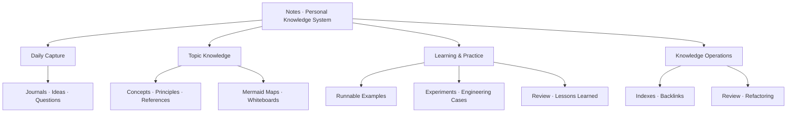
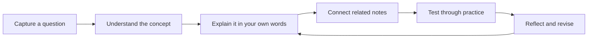
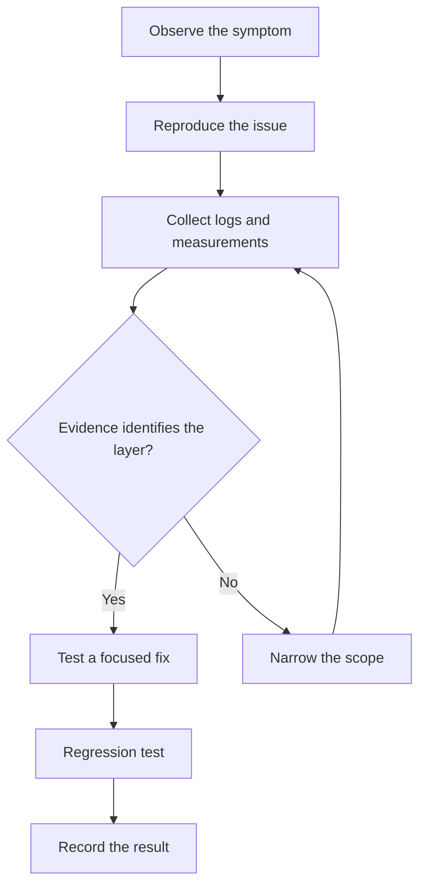

# Notes | Personal Knowledge System

<p align="center">
  <strong>Capture ideas. Connect knowledge. Build understanding.</strong>
</p>

<p align="center">
  A long-term, evolving knowledge base for embedded systems, automotive software, computer science, learning, and personal knowledge management.
</p>

<p align="center">
  <a href="https://logseq.com/"></a>
  <a href="https://www.markdownguide.org/"></a>
  <a href="https://mermaid.js.org/"></a>
  <a href="https://github.com/ilikui/Notes"></a>
</p>

---

## Overview

**Notes** is a Markdown-first personal knowledge repository organized around durable understanding rather than passive information storage. It combines daily capture, topic-oriented notes, linked concepts, visual diagrams, and practical learning records.

The goal is to turn fragmented information into a system that can be searched, connected, reviewed, tested, and reused.


<p align="center"><em>Capture → Understand → Distill → Connect → Apply → Reflect</em></p>

## Explore the Knowledge Base

| Area | Start here |
| --- | --- |
| **Knowledge navigation** | [Knowledge Base Index](pages/知识库导航.md) |
| **Repository roadmap** | [Continuous Improvement Plan](pages/知识库全量完善计划.md) |
| **Writing conventions** | [Note Writing Guidelines](pages/笔记编写规范.md) |
| **Page catalogue** | [Page Catalogue](pages/contents.md) |
| **Logseq workflow** | [Logseq Notes](pages/LogSeq.md) |
| **Automotive software** | [AUTOSAR](pages/AUTOSAR.md) · [Classic Platform](pages/Classic%20Platform.md) · [Communication Stack](pages/Communication%20Stack.md) · [Diagnostic Stack](pages/Diagnostic%20Stack.md) |
| **Embedded & computer science** | [Embedded Systems](pages/嵌入式.md) · [C Language](pages/C语言.md) · [Computer Science Roadmap](pages/CS自学指南.md) |
| **Learning & knowledge management** | [Knowledge Management](pages/知识管理.md) · [Card Notes](pages/卡片笔记.md) · [Reading Management](pages/阅读管理.md) |

## Knowledge Architecture



## The Learning Loop



1. **Capture:** Record questions, ideas, sources, and open tasks while they are fresh.
2. **Distill:** Turn useful information into focused, independently understandable notes.
3. **Connect:** Link concepts, assumptions, examples, counterexamples, and related projects.
4. **Validate:** Add code, measurements, diagrams, references, or reproducible experiments.
5. **Review:** Correct outdated statements and improve navigation as understanding grows.

## Mermaid Diagram Support

Mermaid is the preferred text-based diagram format in this repository because diagrams can be reviewed alongside the notes, version-controlled, and updated without a separate drawing tool.

### Supported diagram types

| Diagram | Typical use |
| --- | --- |
| `flowchart` | Learning paths, software layers, troubleshooting and decision flows |
| `sequenceDiagram` | API interactions, runtime calls and communication sequences |
| `classDiagram` | Data models, interfaces and object relationships |
| `stateDiagram-v2` | State machines, lifecycle and mode transitions |
| `erDiagram` | Data entities and their relationships |
| `timeline` | Milestones and historical sequences |
| `mindmap` | Topic maps and knowledge decomposition |
| `pie` / `xychart` | Simple proportions and data comparisons, where supported |

### Example: troubleshooting a technical issue



### Authoring conventions

- Use fenced code blocks with the language identifier `mermaid`.
- Keep node labels concise; quote labels containing punctuation, parentheses, or special characters.
- Prefer a small number of meaningful nodes over a dense diagram.
- Give each diagram a title or a short sentence explaining what it models.
- Verify that arrow direction, layer boundaries, and decision branches reflect the actual system.
- For engineering notes, distinguish conceptual diagrams from project-specific architecture and identify version/toolchain assumptions where relevant.

### Rendering and compatibility

GitHub renders supported Mermaid code blocks directly in Markdown files. Other readers—such as Logseq-based sites, plugins, static-site generators, and custom single-page applications—may require Mermaid to be explicitly enabled and initialized by that application's renderer.

If a Mermaid block appears as plain text or does not display:

1. Confirm the fenced block starts with ```mermaid and has a matching closing fence.
2. Check the browser console for Mermaid initialization or parsing errors.
3. Check the Network panel for failed Mermaid JavaScript/module requests.
4. Confirm the reader's Markdown renderer supports Mermaid and that its version supports the diagram syntax used.
5. For important diagrams, consider committing an SVG/PNG fallback and referencing it with a relative Markdown image path.

> **Important:** Adding Mermaid source to a note does not, by itself, enable Mermaid in every publishing platform. Rendering support is a responsibility of the target reader or site's build/runtime configuration.

## Repository Layout

| Path | Purpose |
| --- | --- |
| `pages/` | Topic notes, learning guides, indexes, and reference material |
| `journals/` | Daily notes, observations, and idea capture |
| `whiteboards/` | Visual thinking spaces and spatial notes |
| `assets/` | Diagrams and other local visual resources |
| `.github/workflows/` | Repository automation and publishing workflows, when configured |

The exact set of folders and workflows may evolve; use the repository tree as the source of truth.

## Note Quality Principles

A useful note should answer as many of these questions as appropriate:

- **What is it?** Define the concept and its scope.
- **Why does it matter?** Explain the problem it solves.
- **How does it work?** Describe the mechanism, structure, or sequence.
- **How can it be verified?** Provide examples, tests, measurements, or references.
- **When does it not apply?** Record assumptions, limitations, and counterexamples.
- **What is it connected to?** Link related concepts and practical applications.
- **What supports the claim?** Cite reliable sources and note versions for changing technical behavior.

## Working with the Repository

1. Open the repository as a graph in [Logseq](https://logseq.com/).
2. Keep daily capture separate from polished, reusable topic notes.
3. Prefer updating and linking existing pages over creating duplicate pages.
4. Before committing, review Markdown links, Mermaid fences, image paths, and source references.
5. After publishing, inspect the workflow result and the deployed site; a successful commit alone does not prove that the site rendered correctly.

## Maintenance Principles

- Preserve original journals and whiteboards unless a change is explicitly intended.
- Make substantial structural changes in a dedicated branch and review them before merging.
- Prefer original diagrams, properly licensed assets, and official documentation; attribute external material.
- Use diagrams to improve explanation, not as decoration or a substitute for technical accuracy.
- For standards and tool-specific behavior, record the applicable release, configuration context, and validation evidence.
- Track unfinished areas in the [continuous improvement plan](pages/知识库全量完善计划.md), and distinguish completed edits from checks that have not yet been performed.

---

<p align="center">
  <strong>A knowledge system should do more than store information.</strong><br>
  It should help ideas connect, understanding deepen, and learning turn into practice.
</p>
