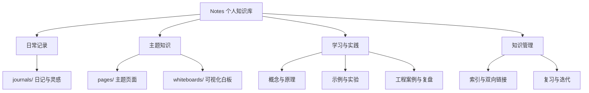

# Notes · 个人知识库

> 将零散的信息整理成可以检索、连接、复用和持续成长的知识。

这是一个以 Logseq 和 Markdown 为基础的个人知识库。仓库保留日常记录、主题笔记、学习资料和可视化白板，并通过持续整理，让知识从“保存下来”逐渐走向“理解、关联与应用”。

> 图示为本仓库采用的知识工作流：收集 → 理解 → 提炼 → 关联 → 实践 → 复盘。

## 快速开始

| 目标 | 入口 |
| --- | --- |
| 浏览主题与学习路线 | [知识库导航](pages/知识库导航.md) |
| 了解全库持续完善策略 | [知识库全量完善计划](pages/知识库全量完善计划.md) |
| 统一笔记结构与写作方法 | [笔记编写规范](pages/笔记编写规范.md) |
| 查看现有页面目录 | [页面目录](pages/contents.md) |
| 学习 Logseq | [Logseq 笔记](pages/LogSeq.md) |
| 汽车电子与 AUTOSAR | [AUTOSAR](pages/AUTOSAR.md)、[Classic Platform](pages/Classic%20Platform.md)、[通信栈](pages/Communication%20Stack.md)、[诊断栈](pages/Diagnostic%20Stack.md) |
| 嵌入式与计算机基础 | [嵌入式](pages/嵌入式.md)、[C 语言](pages/C语言.md)、[计算机自学指南](pages/CS自学指南.md) |
| 知识管理与卡片笔记 | [知识管理](pages/知识管理.md)、[卡片笔记](pages/卡片笔记.md)、[阅读管理](pages/阅读管理.md) |

## 知识库结构

## 推荐学习闭环

1. **先记录：** 在日记中保留问题、想法、来源和待办。
2. **再提炼：** 将有长期价值的内容整理成独立主题页面。
3. **建立连接：** 使用 Logseq 页面链接关联相关概念、反例和实践。
4. **通过实践检验：** 补充代码、图表、实验结果或真实案例。
5. **定期复盘：** 修正过时结论、补充来源，并更新主题索引。

## 主题地图

### 工程与计算机
- **汽车电子与嵌入式：** [汽车电子](pages/汽车电子.md)、[电子电气架构](pages/电子电气架构.md)、[AUTOSAR](pages/AUTOSAR.md)、[嵌入式](pages/嵌入式.md)、[嵌入式软件](pages/嵌入式软件.md)、[嵌入式硬件](pages/嵌入式硬件.md)。
- **AUTOSAR 工程：** [Classic Platform](pages/Classic%20Platform.md)、[BSW 分层](pages/Basic%20Software%20Layer.md)、[配置](pages/Configuration.md)、[通信栈](pages/Communication%20Stack.md)、[诊断栈](pages/Diagnostic%20Stack.md)、[模块索引](pages/Modules.md)、[工具](pages/Tools.md)。
- **编程与计算机基础：** [C 语言](pages/C语言.md)、[计算机自学指南](pages/CS自学指南.md)、[数据结构](pages/数据结构.md)、[编译原理](pages/编译原理.md)、[Git](pages/Git.md)。
- **系统与架构：** [架构设计](pages/架构设计.md)、[软件工程](pages/软件工程.md)、[软件定义汽车](pages/软件定义汽车.md)。

### 学习与知识管理
- **学习方法：** [学习方法](pages/学习方法.md)、[学习策略](pages/学习策略.md)、[学习管理](pages/学习管理.md)。
- **个人知识系统：** [知识管理](pages/知识管理.md)、[笔记管理](pages/笔记管理.md)、[卡片笔记](pages/卡片笔记.md)、[打造第二大脑](pages/打造第二大脑.md)。
- **阅读与信息输入：** [阅读管理](pages/阅读管理.md)、[博客收集](pages/博客收集.md)、[好书推荐](pages/好书推荐.md)。

> 以上入口指向仓库中已有的页面。导航不代表每个专题都已完成，请以页面实际内容为准。

## 笔记质量标准

一篇可复用的主题笔记应尽可能回答：**是什么、为什么、如何工作、如何验证、何时不适用、与什么有关、依据是什么。** 对技术标准、软件行为和易变事实，注明来源、版本和验证环境。

## 本地使用与发布

1. 安装 [Logseq](https://logseq.com/)。
2. 克隆仓库，在 Logseq 中打开仓库目录。
3. 在 `pages/` 中维护主题页面，在 `journals/` 中记录日常内容；新增页面时补充相关索引和链接。
4. 提交前检查 Markdown 链接、Mermaid 语法与图片路径。
5. 仓库已有 GitHub Actions 工作流。发布后请检查 Actions 运行结果及 GitHub Pages 配置，不要仅凭提交成功判断网站已正确更新。

## 维护原则

- 优先新增导航和补充内容，不批量删除原始日记、白板或插件配置。
- 先检查已有页面，尽量更新与链接旧页面，避免重复建页。
- 图片使用自有图示、合法素材或官方文档图片，并注明来源。
- Mermaid 图用于解释真实关系，不以复杂度代替准确性。
- 外部资料应提炼成自己的理解并保留出处，避免无来源的大段复制。
- 重要结构调整先在独立分支完成，检查链接和发布流程后再合并。
- 按[全库完善计划](pages/知识库全量完善计划.md)分批推进，记录已完成范围与未验证事项。

**目标：** 让每条笔记不仅能被找到，还能被理解、连接、验证，并在未来的学习和工作中再次发挥作用。
