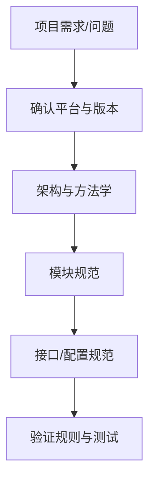

# AUTOSAR 标准与规范入口

AUTOSAR 文档覆盖架构、方法学、接口、模块行为、配置描述、通信和安全等多个方面。阅读标准时，必须先确认平台类型、发布版本和文档适用范围，避免把不同版本的定义混用。

## 阅读路径

## 标准类别

- 软件架构标准：理解平台分层、组件关系与接口边界。
- 通信相关标准：理解信号、PDU、路由、接口与总线抽象。
- 操作系统相关标准：理解任务、事件、资源、中断和时序服务。
- 诊断相关标准：理解诊断服务、会话、安全访问和故障信息管理。
- 存储相关标准：理解非易失性数据块、读写请求与恢复机制。
- 方法学与模板：理解系统描述、ECU 配置、生成工件和交付流程。

## 如何阅读规范

1. 记录文档名称、版本号、发布日期和适用平台。
2. 先看术语、范围、约束和依赖，再看 API 与配置项。
3. 将规范条款映射到项目配置、生成代码和测试案例。
4. 对供应商扩展、项目约定和标准要求分别标注。
5. 记录条款编号及结论依据，避免只保存无上下文的截图。

官方入口：https://www.autosar.org/
