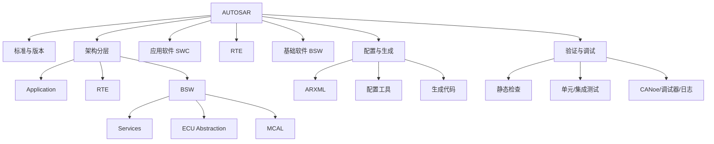
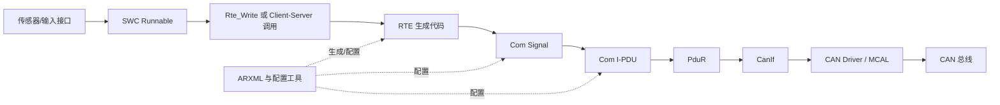
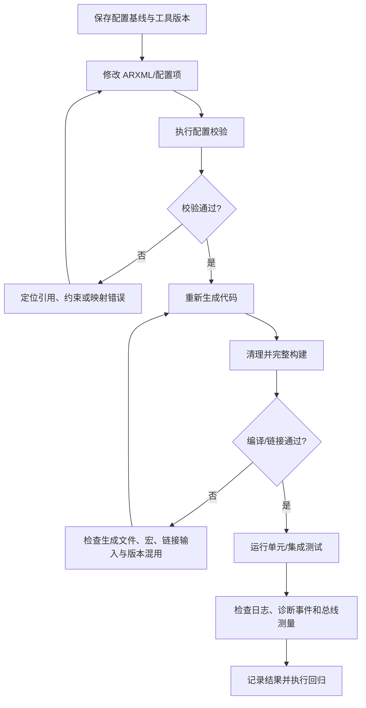

# AUTOSAR 学习总入口

> AUTOSAR（AUTomotive Open System ARchitecture）是汽车电子软件架构的开放标准合作体系，旨在提升软件复用、跨供应商协作、平台可扩展性和生命周期可维护性。项目实践中应以项目采用的 AUTOSAR 版本、供应商交付文档和安全要求为准。

- 官方网站：https://www.autosar.org/
- 学习资料索引：https://explorer.globe.engineer/?q=autosar
- 版本入口：[[Versions]]
- 分层架构：[[Layers]]
- 模块索引：[[Modules]]
- 工具链：[[Tools]]
- 相关领域：[[汽车电子]]、[[电子电气架构]]、[[软件定义汽车]]

## 学习目标

完成学习后，应能够解释 ECU 软件从应用需求到硬件驱动的分层关系，读懂关键 ARXML 配置，追踪信号从 SWC 到总线的路径，并能用配置、生成代码、运行日志和总线测量共同定位问题。

## 知识地图

## 建议学习顺序

| 阶段 | 主题 | 可交付成果 |
|---|---|---|
| 1. 建立概念 | Classic Platform、分层、术语、版本 | 能画出 ECU 软件分层图 |
| 2. 理解应用 | SWC、Runnable、Port、Interface、数据类型 | 能解释组件接口和运行实体 |
| 3. 理解运行时 | RTE、事件、任务映射、数据访问 | 能追踪一次 Rte_Read/Rte_Write |
| 4. 理解基础软件 | OS、诊断、通信、NvM、模式管理 | 能描述模块职责与依赖 |
| 5. 工程配置 | ARXML、配置约束、代码生成 | 能从配置追到生成文件 |
| 6. 故障定位 | 编译、链接、启动、通信、诊断故障 | 能形成证据链和复现步骤 |

## 工程分析方法

1. **先确定基线**：记录 AUTOSAR 版本、MCU、编译器、工具版本、供应商包版本和项目变体。
2. **从需求找入口**：确认信号、诊断服务、存储需求或硬件资源对应的需求编号。
3. **沿链路追踪**：ARXML 配置 → 生成代码 → 调用关系 → 运行时观测。
4. **区分事实与推测**：记录日志、代码位置、测量结果；推测必须通过实验验证。
5. **保留复现条件**：配置版本、输入条件、步骤、预期结果、实际结果和回归测试。

## 典型问题检查表

- RTE API 未生成：检查 SWC Port/Interface、Runnable 访问、数据类型映射、连接器和生成配置。
- 通信信号未发送：检查 Com 信号映射、PDU 路由、通信控制状态、CanIf/驱动配置以及总线测量。
- 诊断请求无响应：检查 Dcm 服务配置、会话/安全等级、PduR 路由、传输层和应用回调。
- NvM 数据异常：检查 Block 配置、RAM/NV/ROM 镜像、读写触发、CRC、初始化和掉电场景。
- 启动异常：检查启动代码、时钟、内存布局、OS 启动顺序、初始化列表和链接映射。

## 笔记维护

每个专题至少包含：问题定义、适用范围、原理图或 Mermaid、工程配置入口、代码/日志证据、常见错误、验证步骤、参考来源和相关页面链接。版本相关结论必须注明适用版本，避免将某个项目实现误写成通用标准。

## 从 SWC 到 CAN 报文：端到端追踪示例

下面以“应用组件更新一个车辆状态信号，并经 CAN 发送”为例。具体模块名称、配置项和生成文件会因 AUTOSAR 版本、供应商工具及项目架构而异；此图用于建立排查路径，不代表所有项目都采用完全相同的实现。

### 追踪时应记录的证据

| 层次 | 要确认的问题 | 可用证据 |
|---|---|---|
| SWC | Runnable 是否被正确触发，输入值是否合理？ | Runnable 断点、单元测试、应用日志 |
| RTE | Port、Interface、数据类型和连接器是否一致？ | ARXML、RTE 生成文件、编译告警 |
| Com | 信号是否映射到预期 I-PDU，更新位/发送模式是否符合配置？ | Com 配置、生成符号、运行时变量 |
| PduR | 对应 PDU 是否存在正确路由路径？ | 路由配置、生成代码、DET/DEM 记录（若启用） |
| CanIf/驱动 | PDU 是否进入发送接口，控制器是否处于可发送状态？ | API 返回值、控制器状态、驱动日志 |
| 总线 | 报文 ID、周期、长度和信号值是否符合预期？ | CANoe/总线分析仪抓包 |

建议沿着“应用值 → RTE 接口 → Com 信号 → I-PDU → 驱动发送请求 → 总线帧”逐段验证。不要仅凭某个 API 被调用，就认定报文已经成功发到总线上。

## RTE/SWC 配置核查清单

- [ ] SWC 的 Port 类型与通信意图匹配（Sender-Receiver 或 Client-Server）。
- [ ] Port Interface、Data Element、Operation 和数据类型引用有效。
- [ ] SWC 实例连接器与系统/ECU 映射完整。
- [ ] Runnable 的触发事件、周期或数据接收事件配置正确。
- [ ] Runnable 访问的数据元素与生成的 RTE API 一致。
- [ ] Runnable 到 OS Task 的映射及任务优先级符合时序需求。
- [ ] 生成代码来自当前配置版本，未混用旧生成文件。
- [ ] 编译和链接输入中包含正确的生成源文件与配置头文件。
- [ ] 通过单元测试或集成测试验证初始化、有效数据、无效数据和边界值。

### 常见现象与排查方向

| 现象 | 优先检查 | 不应直接下的结论 |
|---|---|---|
| 找不到 `Rte_Read` / `Rte_Write` | Port 类型、数据元素、Runnable 访问、生成配置 | 不要先认定工具故障 |
| API 存在但值不更新 | Runnable 触发、数据连接、初始化顺序、写入条件 | API 被调用不等于数据源正确 |
| 应用值正确但总线信号不变 | Com 映射、发送模式、I-PDU 触发、PduR 路由 | 不要只检查 CAN 驱动 |
| 总线有帧但信号值错误 | 位位置、长度、字节序、缩放/偏移、无效值定义 | 不要仅凭报文 ID 相同认定映射正确 |
| 偶发丢帧或周期抖动 | 任务调度、发送模式、总线负载、控制器状态与错误计数 | 不要把所有时序问题归为通信栈缺陷 |

## 变更配置后的可复现验证流程

每次变更至少记录：提交号或配置版本、工具版本、变更项、构建结果、测试输入、测量证据、未覆盖风险。若项目采用受控构建流程，应遵循项目规定的生成、评审和发布步骤，而不是直接覆盖交付目录。

