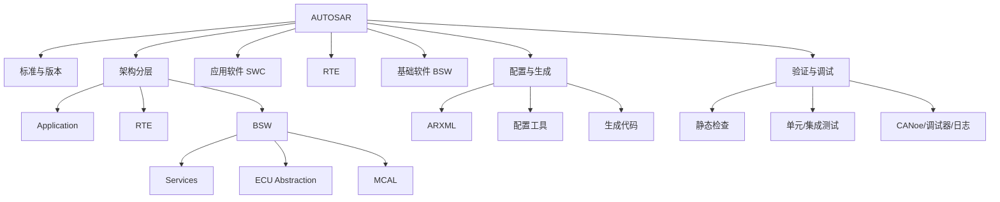

# AUTOSAR 学习总入口

> AUTOSAR（AUTomotive Open System ARchitecture）是汽车电子软件架构的开放标准合作体系，旨在提升软件复用、跨供应商协作、平台可扩展性和生命周期可维护性。项目实践中应以项目采用的 AUTOSAR 版本、供应商交付文档和安全要求为准。

- 官方网站：https://www.autosar.org/
- 学习资料索引：https://explorer.globe.engineer/?q=autosar
- 版本入口：[[Versions]]
- 分层架构：[[Layers]]
- 模块索引：[[Modules]]
- 工具链：[[Tools]]
- 相关领域：[[汽车电子]]、[[电子电气架构]]、[[软件定义汽车]]

## 学习目标

完成学习后，应能够解释 ECU 软件从应用需求到硬件驱动的分层关系，读懂关键 ARXML 配置，追踪信号从 SWC 到总线的路径，并能用配置、生成代码、运行日志和总线测量共同定位问题。

## 知识地图

## 建议学习顺序

| 阶段 | 主题 | 可交付成果 |
|---|---|---|
| 1. 建立概念 | Classic Platform、分层、术语、版本 | 能画出 ECU 软件分层图 |
| 2. 理解应用 | SWC、Runnable、Port、Interface、数据类型 | 能解释组件接口和运行实体 |
| 3. 理解运行时 | RTE、事件、任务映射、数据访问 | 能追踪一次 Rte_Read/Rte_Write |
| 4. 理解基础软件 | OS、诊断、通信、NvM、模式管理 | 能描述模块职责与依赖 |
| 5. 工程配置 | ARXML、配置约束、代码生成 | 能从配置追到生成文件 |
| 6. 故障定位 | 编译、链接、启动、通信、诊断故障 | 能形成证据链和复现步骤 |

## 工程分析方法

1. **先确定基线**：记录 AUTOSAR 版本、MCU、编译器、工具版本、供应商包版本和项目变体。
2. **从需求找入口**：确认信号、诊断服务、存储需求或硬件资源对应的需求编号。
3. **沿链路追踪**：ARXML 配置 → 生成代码 → 调用关系 → 运行时观测。
4. **区分事实与推测**：记录日志、代码位置、测量结果；推测必须通过实验验证。
5. **保留复现条件**：配置版本、输入条件、步骤、预期结果、实际结果和回归测试。

## 典型问题检查表

- RTE API 未生成：检查 SWC Port/Interface、Runnable 访问、数据类型映射、连接器和生成配置。
- 通信信号未发送：检查 Com 信号映射、PDU 路由、通信控制状态、CanIf/驱动配置以及总线测量。
- 诊断请求无响应：检查 Dcm 服务配置、会话/安全等级、PduR 路由、传输层和应用回调。
- NvM 数据异常：检查 Block 配置、RAM/NV/ROM 镜像、读写触发、CRC、初始化和掉电场景。
- 启动异常：检查启动代码、时钟、内存布局、OS 启动顺序、初始化列表和链接映射。

## 笔记维护

每个专题至少包含：问题定义、适用范围、原理图或 Mermaid、工程配置入口、代码/日志证据、常见错误、验证步骤、参考来源和相关页面链接。版本相关结论必须注明适用版本，避免将某个项目实现误写成通用标准。
