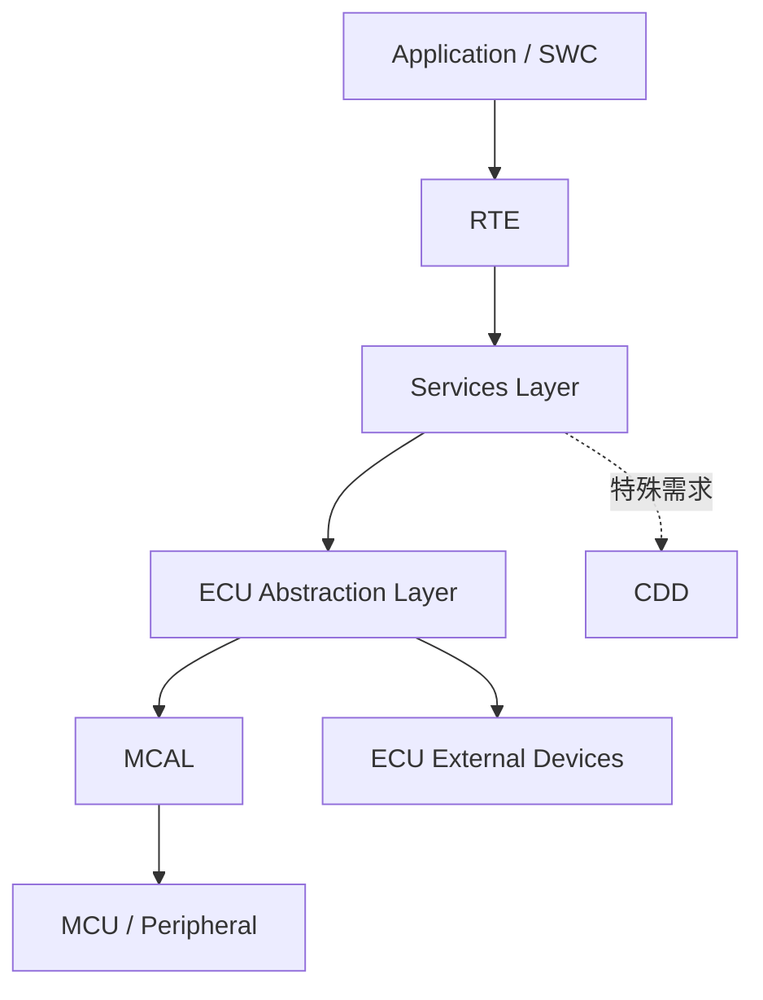

# AUTOSAR 基础软件分层

Classic Platform 的 BSW 通常按服务层、ECU 抽象层、微控制器抽象层等职责组织。具体模块集合和依赖以采用的标准版本及供应商实现为准。

- [[Services]]：系统服务、通信服务、诊断和存储等公共能力
- [[ECU Abstraction]]：屏蔽 ECU 板级器件差异，提供统一访问接口
- [[MCAL(Microcontroller Abstraction Layer)]]：封装 MCU 外设与底层驱动
- [[CDD(Complex Device Drivers)]]：处理标准模块难以覆盖的特殊硬件或时序需求

## 分层的工程价值

- 依赖清晰：上层通过定义好的接口访问下层能力。
- 可移植：更换 MCU 或板级器件时，尽量限制修改范围。
- 可配置：通过配置描述和生成工具形成项目所需模块与连接。
- 可验证：可以分层测试接口契约、驱动行为和集成路径。

## 评审要点

检查调用是否跨越了不该依赖的层，硬件相关逻辑是否放在合适位置，初始化顺序是否满足依赖，配置项是否与目标 MCU 和板级设计一致，以及异常状态是否向上层正确传播。
