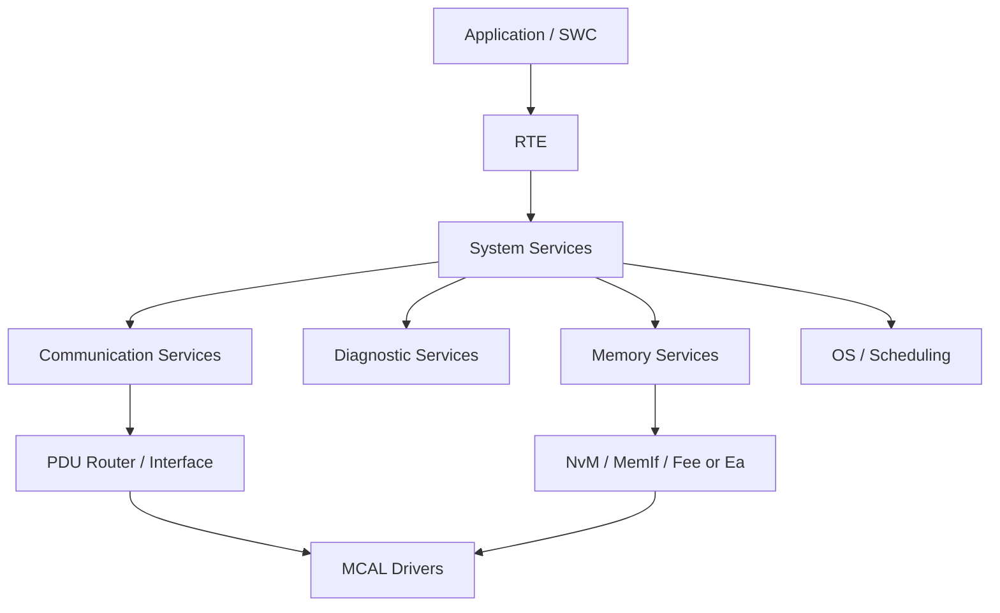

# AUTOSAR 基础软件（BSW）

BSW 为应用软件提供操作系统、通信、诊断、存储、状态管理和硬件访问等平台服务。具体模块、依赖和配置行为应以项目使用的 AUTOSAR 版本与供应商实现为准。

## 主要功能域

- 操作系统与调度：[[OS(Operating System)]]
- 通信服务：[[Communication Stack]]、[[Communication]]
- 诊断服务：[[Diagnostic Stack]]
- 存储服务：[[Memory]]
- 硬件抽象与驱动：[[Basic Software Layer]]、[[ECU Abstraction]]

## 工程配置与调试路径

1. 从需求确认服务的使用者、触发条件和异常行为。
2. 检查模块配置、模块版本、依赖关系和生成日志。
3. 追踪配置项到生成代码、初始化顺序和运行时调用。
4. 检查错误处理、超时、重试、默认值和状态切换。
5. 用单元测试、集成测试、日志和总线/调试器测量验证。

## 常见误区

- BSW 不等于驱动程序集合：其中还包括服务层、通信、诊断、存储和系统管理。
- 标准模块名不保证所有供应商实现完全相同；需检查供应商文档和项目封装。
- 配置通过不代表运行时行为正确；必须验证初始化、调度、资源与错误路径。
