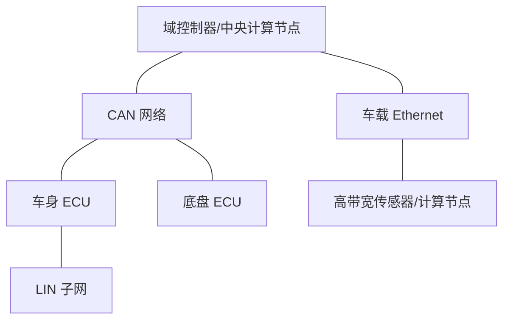

# 车载总线系统

车载总线把 ECU、传感器、执行器和计算节点连接起来。选择总线技术时，需要考虑数据量、时延、确定性、拓扑、成本、诊断需求和系统安全，而不能只比较标称速率。

- [[CAN]]：广泛用于控制与诊断场景。
- [[LIN]]：低成本子网，适用于相对简单的传感器/执行器通信。
- [[FlexRay]]：面向特定确定性通信需求，实际项目采用情况需核实。
- [[Ethernet]]：适用于高带宽数据与多种上层协议。

## 典型网络结构

此图为概念示意，真实车辆网络取决于车型 E/E 架构。

## 总线问题定位

1. 确认网络拓扑、节点供电、接地、线束和终端。
2. 检查控制器/收发器初始化、波特率和采样配置。
3. 检查报文周期、ID、长度、信号编码和通信状态。
4. 观察错误帧、错误计数、Bus-Off、丢包和总线负载。
5. 用日志与总线测量对齐时间戳，区分应用层问题与物理层问题。

记录测试车辆/台架、节点软件版本、总线配置和复现步骤，避免把单次成功通信当作可靠性证明。
