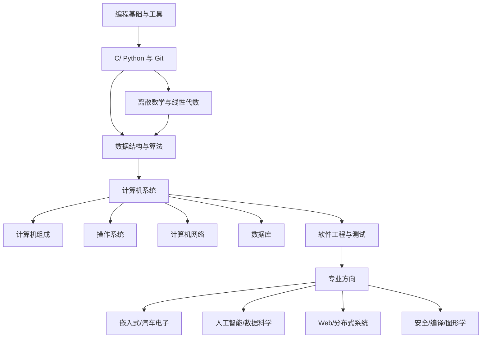

# 计算机科学自学指南

- 主要参考：https://csdiy.wiki/
- 本页作用：将课程、练习、项目和复盘连接成一条可执行路线；资源清单只是入口，不等于学习完成。

## 学习路线图

## 建议顺序与验收标准

| 阶段 | 核心主题 | 通过标准 |
|---|---|---|
| 0. 工具 | 命令行、编辑器、Git、调试 | 能独立创建仓库、提交、定位错误 |
| 1. 编程 | C 或 Python、函数、数据结构、测试 | 能完成一个有输入校验和测试的小项目 |
| 2. 数学 | 逻辑、集合、证明、概率、线性代数 | 能解释算法和模型背后的基本假设 |
| 3. 算法 | 复杂度、数组、链表、树、图、排序搜索 | 能分析时间/空间复杂度并实现典型算法 |
| 4. 系统 | 指令、内存、进程线程、文件、网络、数据库 | 能通过实验解释系统行为 |
| 5. 工程 | 模块化、测试、CI、文档、代码审查 | 项目可复现、可测试、可维护 |
| 6. 专业方向 | 选定一个方向持续深入 | 完成可展示的项目并写出技术复盘 |

## 课程与资源入口

- [[必学工具]]
- [[好书推荐]]
- [[高等数学]]
- [[C语言]]
- [[数据结构]]
- [[编译原理]]
- [[软件工程]]
- [[嵌入式]]
- [[AUTOSAR]]

原始指南中的扩展主题包括：电子基础、体系结构、操作系统、并行与分布式系统、计算机安全、计算机网络、数据库、编程语言、图形学、Web 开发、数据科学、人工智能、机器学习、深度学习和机器学习系统。应根据目标选择，不必按清单全部修完。

## 如何学习一门课程

1. 先写下学习问题和预期成果。
2. 课程学习与动手实验交替进行，不要只看视频。
3. 每个章节至少做一道题或一个小实验。
4. 把错误分成概念误解、实现错误、环境问题和题意理解问题。
5. 每阶段产出可运行代码、测试、图示和一篇复盘。
6. 定期回看基础知识，并用项目检验是否能迁移。

## 项目驱动的验证

优先选择能覆盖多个知识点的小项目，例如命令行任务管理器、文件索引器、简单解释器、TCP 客户端、日志分析工具或嵌入式传感器采集程序。项目必须包含 README、运行方式、边界条件、测试和已知限制。
