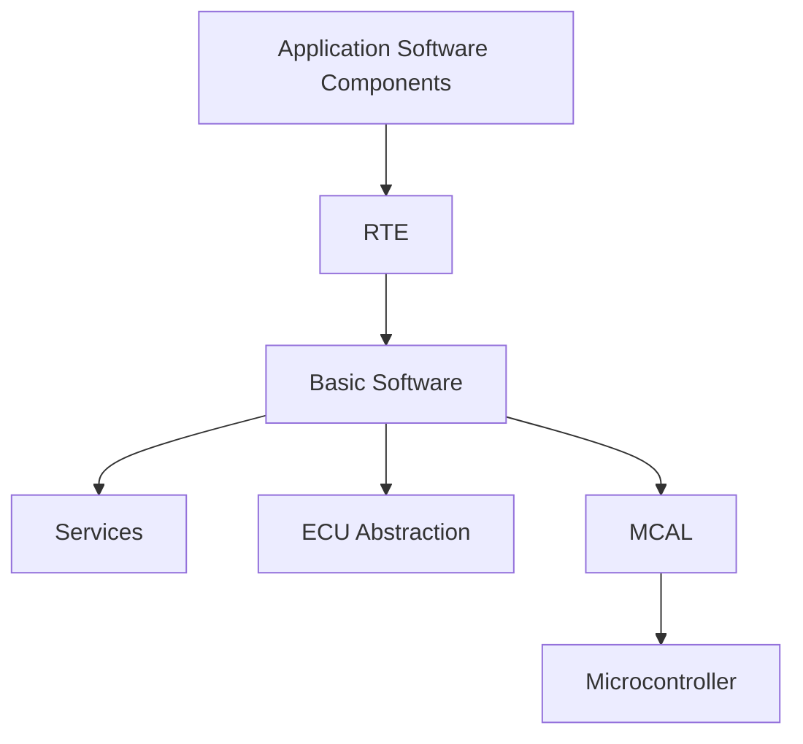

# AUTOSAR Classic Platform 学习入口

- 资料索引：https://explorer.globe.engineer/?q=Autosar+Classic+Platform
- [[Architecture]]
- [[Methodology]]
- [[Standards]]
- [[Basic Software Layer]]
- [[AUTOSAR]]
- [[Configuration]]

Classic Platform 主要面向基于 MCU 的 ECU 控制场景，采用分层架构，通过 SWC、RTE 和 BSW 等部分组织应用、运行时通信和基础服务。它强调接口标准化、配置驱动的集成，以及对资源和时序约束的工程管理。

## 核心结构

## 入门后应能回答

1. SWC、Runnable、Port、Interface 分别解决什么问题？
2. RTE 如何连接组件，并把组件访问映射到运行时机制？
3. BSW 服务层、ECU 抽象层与 MCAL 的职责如何区分？
4. ARXML 描述什么，配置工具生成哪些工件？
5. 一个信号从应用层到 CAN 报文经过哪些模块？
6. 如何区分标准要求、供应商实现和项目自定义约定？

## 实践任务

选取一个实际信号，画出从需求、SWC 接口、RTE、COM、PduR、总线接口到驱动的路径，并标出每一步对应的配置文件、生成代码和验证手段。
