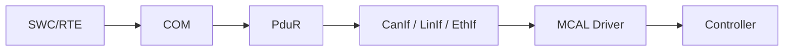

# AUTOSAR 通信栈

通信栈负责把应用数据映射到总线报文，并处理路由、接口、控制器访问与通信状态。模块链路取决于使用的总线技术和项目配置，以下是典型概念模型。

- [[Communication]]
- [[CAN]]
- [[LIN]]
- [[FlexRay]]
- [[Basic Software]]
- [[Configuration]]

## 排查发送失败

1. 应用信号是否更新，发送触发条件是否满足？
2. COM 信号、信号组、PDU 和发送模式是否正确配置？
3. PduR 路由是否连接到预期目的模块？
4. 接口与驱动初始化、控制器模式和通信允许状态是否正常？
5. 是否发生 Bus-Off、缓冲区满、超时或网络管理状态异常？
6. 总线测量中是否出现目标报文？周期、长度和信号编码是否正确？

## 必须保留的证据

配置版本、PDU/报文标识、预期周期、抓包时间戳、错误计数、通信状态以及修改前后对比。不要只凭某一层的返回值判断整条链路成功。
