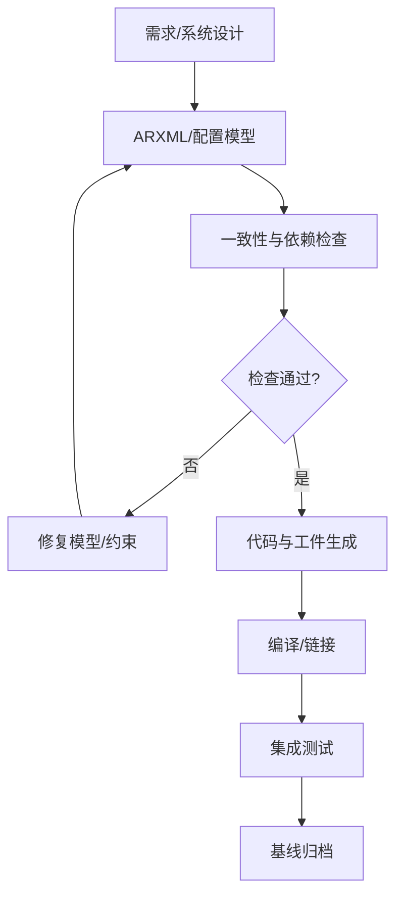

# AUTOSAR 配置管理

AUTOSAR 工程通常通过系统描述、ECU 配置描述和模块参数配置表达软件组件、接口、映射、依赖与实现细节，再由工具检查并生成代码或其他交付工件。

## 两类核心配置议题

- 参数配置（Parameter Configuration）：模块参数、接口映射、资源、时序和行为选项。
- 变体处理（Variant Handling）：产品/车型/ECU 变体之间的可选功能与差异管理。变体条件必须与项目定义的选择规则保持一致。

## 配置到代码的闭环

## 配置评审清单

1. 版本、Schema、供应商包和工具版本是否匹配？
2. 引用、端口连接、数据类型和模块依赖是否完整？
3. 变体条件是否互斥、完备且与目标 ECU 一致？
4. 生成工件是否可复现，是否记录工具参数和输入基线？
5. 是否对生成代码进行了差异审查与构建验证？
6. 变更是否关联需求、缺陷和回归测试？

## 工程建议

不要直接手工修改工具生成的文件来掩盖配置问题。优先修复源配置并重新生成；若项目确实存在手写扩展，应明确其边界、生成顺序和维护责任。
