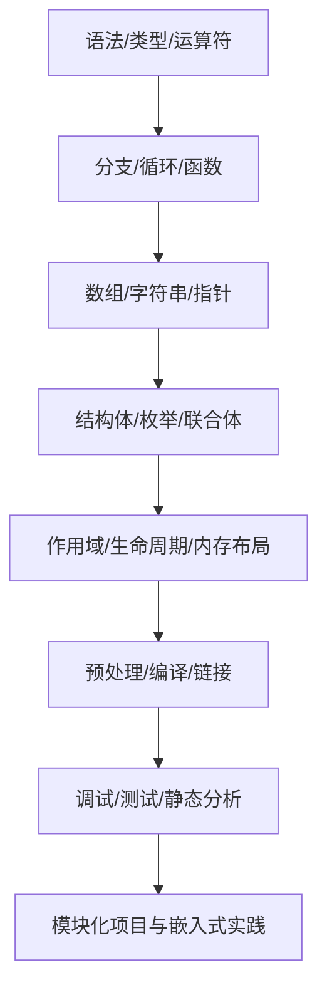

# C 语言学习路线与工程实践

C 是一种编译型、通用且常用于系统软件和嵌入式开发的语言。学习时要同时理解语法、对象生命周期、内存模型、编译链接、未定义行为与调试方法。

> **重要说明：** C 标准并不保证 `short`、`int`、`long`、`float`、`double` 在所有平台上的固定字节数。使用 `sizeof` 查看当前实现的对象大小，并结合 `limits.h`、`float.h` 和目标 ABI 文档确认范围。一个 C 字节（`sizeof(char)` 的单位）不一定等于 8 位。

## 学习路线



## 可运行的最小示例

```c
#include <stdio.h>

int main(void)
{
    int values[] = {3, 5, 8};
    size_t count = sizeof values / sizeof values[0];

    for (size_t i = 0; i < count; ++i) {
        printf("values[%zu] = %d\\n", i, values[i]);
    }

    return 0;
}
```

编译器支持 C11 时可用：`cc -std=c11 -Wall -Wextra -Wpedantic main.c -o main`。在嵌入式工具链中，应使用项目指定的编译器、语言标准和警告选项。

## 每个主题都要验证

- 定义：能否用自己的话解释？
- 示例：是否能编译并运行？
- 边界：空输入、最大/最小值、越界和错误返回如何处理？
- 内存：对象何时创建、何时失效、谁拥有资源？
- 工具：编译告警、调试器、单元测试和静态分析能否提供证据？
- 关联：链接到 [[Memory Management]]、[[Registers]]、[[编译原理]] 和 [[数据结构]]。

## 工程安全提示

避免越界访问、悬空指针、未初始化读取、格式字符串错误和有符号整数溢出。对动态内存要明确分配失败与释放责任；对硬件寄存器则需遵守芯片手册与编译器对 volatile/内存屏障的规定。

---

## 原始笔记与示例（保留并持续整理）

- 
- 初级教程
	- 基本概念
	- 数据类型
		- |说明|字符型|短整型|整型|长整型|单精度浮点型|双精度浮点型|
		  |--|--|--|--|--|--|--|
		  |数据类型|`char`|`short`|`int`|`long int`|`float`|`double`|
		  |`sizeof` 大小|1 字节|实现相关|实现相关|实现相关|实现相关|实现相关|
		- 基本数据类型
			- 数值类型
				- 整型
					- 短整型 `short`
					- 整型 `int`
					- 长整型 `long`
				- 浮点型
					- 单精度型 `float`
					- 双精度型 `double`
			- 字符类型char
		- 派生数据类型
		  collapsed:: true
			- 数组
			- 结构体
			- 共用体
			- 枚举类型
		- 指针类型
		- 空类型void
	- 运算符
		- 算术运算符
		- 关系运算符
		- 逻辑运算符
		- 赋值运算符
		- 位运算符
		- 其他运算符
	- 数组
		- 一维数组
			- > 而C99规定，可以在初始化列表中使用带方括号的下标指明待初始化的元素
			- ```c
			  #include <stdio.h>
			  #define MONTHS 12
			  
			  int main(int argc, char const *argv[])
			  {
			  
			      int daya[MONTHS] = {31, 28, [4] = 31, 30, 31, [1] = 29};
			      int index;
			      for (index= 0; index < MONTHS; index++)
			      {
			         printf("%2d   %d\n",index+1,daya[index]);
			      }
			      
			      return 0;
			  }
			  
			  ```
		- 多维数组
		- 数组与指针
	- 控制结构
		- `if`语句
		- `switch` 语句
		- `for`循环
		  > 语法
		  
		  ```c 
		  for ( init; condition; increment )
		  {
		     statement(s);
		  }
		  ```
		  > for循环的控制流
		  1. **init** 会首先被执行，且只会执行一次。这一步允许您声明并初始化任何循环控制变量。您也可以不在这里写任何语句，只要有一个分号出现即可。
		  2. 接下来，会判断 **condition**。如果为真，则执行循环主体。如果为假，则不执行循环主体，且控制流会跳转到紧接着 for 循环的下一条语句。
		  3. 在执行完 for 循环主体后，控制流会跳回上面的 **increment** 语句。该语句允许您更新循环控制变量。该语句可以留空，只要在条件后有一个分号出现即可。
		  4. 条件再次被判断。如果为真，则执行循环，这个过程会不断重复（循环主体，然后增加步值，再然后重新判断条件）。在条件变为假时，for 循环终止。
		- `while`循环
		- `do...while`循环
	- 指针
		- 指针的定义
		  id:: 65e6a7a5-dca9-4478-946b-0a81e6ecf4be
		  
		  > 每一个变量都有一个内存位置，每一个内存位置都定义了可使用 &运算符访问的地址，它表示了在内存中的个地址。
		- > 指针也就是内存地址，指针变量是用来存放内存地址的变量。就像其他变量或常量一样，您必须在使用指针存储其他变量地址之前，对其进行声明。
		- ```c
		  
		  int main ()
		  {
		      int var_runoob = 10;
		      int *p;              // 定义指针变量
		      p = &var_runoob;
		   
		     printf("var_runoob 变量的地址： %p\n", p);
		     return 0;
		  }
		  ```
		- 指针的运算
		- 指针与数组
		- 指针与结构体
	- 函数
		- 函数申明
			- ```c
			  #include <stdio.h>
			  #deifne ADDRESS "101 Megabuck Plaza"
			  #define PLACE "Megapolis, CA 94904"
			  #define WIDTH 40
			  
			  void starbar(void);/*函数申明*/
			  
			  int main(void)
			  {
			    
			    starbar();/*函数调用*/
			    
			    return 0;
			  }
			  
			  void starbar(void)/*函数定义*/
			  {
			    printf("*************************")
			  }
			  ```
			- 其中 `void starbar(void);` 就是函数的申明
		- 函数定义
			- ```c
			  void starbar(void)/*函数定义*/
			  {
			    printf("*************************")
			  }
			  ```
		- 函数参数
		- 递归函数
- 进阶主题
	- 多线程编程
		- 线程创建与管理
		- 线程同步
	- 网络编程
		- 套接字编程
		- 客户端-服务器模型
	- 跨平台开发
		- 编译器与标准库
		- Makefile使用
- 高级概念
	- 内存管理
	  collapsed:: true
		- 动态内存分配
		- 内存泄漏
	- 动态内存分配
	- 模块化编程
	- 错误处理
	- 位操作
	- 内联函数
	- 位段
	- 文件操作
		- 文件打开与关闭
		- 读写文件
	- 预处理器指令
		- `#define指令`
		- `#include指令`
	- 指针高级应用
		- 函数指针
		- 指针数组
		- 指向指针的指针
	- [[数据结构]]