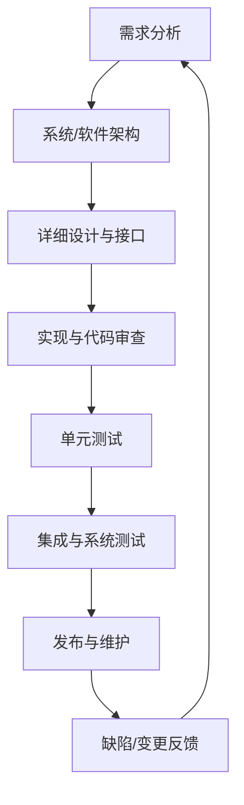

# 嵌入式软件开发流程

典型工程流程包含需求工程、系统设计、软件实现、集成验证和维护。实际项目可能采用 V 模型、迭代开发或混合流程，但每个阶段都应有可追溯的输入、输出和验收条件。

## 阶段交付物

| 阶段 | 典型交付物 | 主要检查 |
|---|---|---|
| 需求 | 需求条目、验收条件、追踪关系 | 是否明确、可测试、无歧义 |
| 架构 | 组件图、接口、质量属性和决策记录 | 职责边界、依赖与风险 |
| 设计 | 模块设计、状态机、数据流、错误处理 | 边界条件和可验证性 |
| 实现 | 代码、构建配置、静态分析结果 | 规范、复杂度、可维护性 |
| 测试 | 测试用例、日志、覆盖率和缺陷记录 | 需求覆盖与异常路径 |
| 发布 | 版本、构建工件、变更说明、回滚方案 | 可复现性与基线一致性 |

## 变更控制

每个变更都应说明原因、影响范围、风险、验证计划和回滚条件。修复缺陷时不仅验证“原问题消失”，还要检查相邻功能与异常路径是否受到影响。
