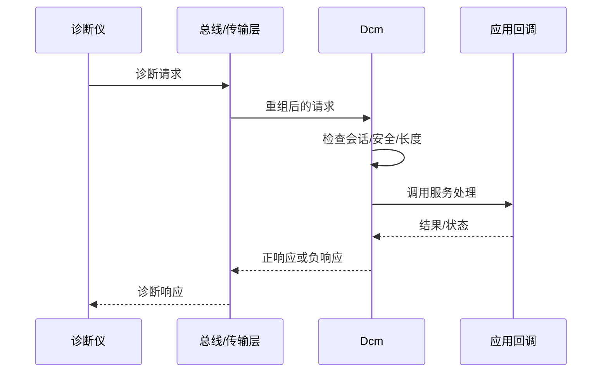

# 车载诊断栈

诊断栈负责接收诊断请求、检查会话和访问权限、调用服务处理逻辑，并将结果按协议发送回诊断仪。具体协议与模块路径由项目架构和配置决定。

- [[UDS]]：统一诊断服务
- [[KWP2000]]：较早的车载诊断协议体系，是否适用取决于项目
- 相关模块：Dcm、PduR、传输层、通信接口、Dem、NvM（具体组合按项目确认）

## 常见定位方向

- 无响应：检查物理链路、寻址、PDU 路由、传输层和 Dcm 初始化。
- 条件不满足：检查会话、安全等级、车辆状态条件和服务配置。
- 负响应：确认 NRC、请求长度、子功能和服务处理返回值。
- 响应超时：检查任务调度、异步处理、P2/P2* 等计时配置与网络传输。
- 数据不正确：检查 DID/Routine 配置、应用回调、字节序、长度和数据有效性。

## 记录一次诊断问题

保留请求原始字节、寻址方式、会话/安全状态、响应原始字节、时间戳、软件版本、相关配置项和复现步骤。诊断安全访问等敏感功能应在授权环境中测试。
