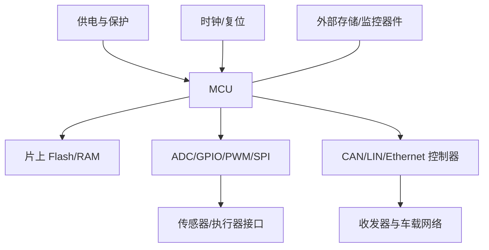

# ECU 硬件组成

ECU（Electronic Control Unit）是汽车电子系统中的电子控制单元。它将处理器、存储器、电源与时钟、通信接口、输入输出电路和保护电路组合起来，完成感知、控制、通信和诊断等任务。

- [[Microcontroller]]：执行程序并提供片上外设。
- [[Memory]]：保存运行数据、程序和需要掉电保持的数据。
- [[Communication Interfaces]]：连接 CAN、LIN、Ethernet 或其他通信网络。
- [[Hardware Architecture]]：硬件组成与接口关系。
- [[嵌入式硬件]]：电路与测量基础。

## 硬件故障排查顺序

1. 测量供电电压、纹波、接地和上电时序。
2. 检查时钟源、复位释放和启动模式。
3. 确认 MCU 型号、内存布局、引脚复用和外设时钟。
4. 检查接口电平、收发器使能、终端与线束。
5. 将示波器/逻辑分析仪测量与软件寄存器、日志时间戳对齐。

任何寄存器配置都应与目标芯片参考手册和板级原理图核对。
