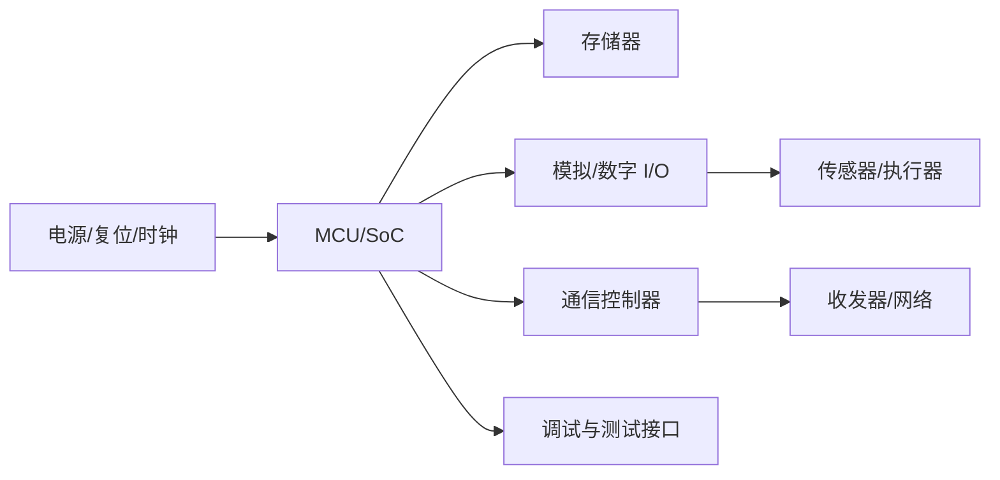

# 硬件架构

硬件架构描述处理器、存储器、外设、通信接口、电源、时钟和外部器件如何连接，并说明性能、实时性、功耗和可靠性约束。

- [[Network Architecture]]：ECU 与总线之间的连接。
- [[ECU Hardware]]：单个 ECU 的主要硬件组成。
- [[嵌入式硬件]]：电源、时钟、复位、接口与测量。
- [[嵌入式系统]]：硬件和软件协同运行的整体。

## 架构评审问题

- 处理器算力、内存和外设资源是否满足最坏负载？
- 电源、时钟和复位是否满足启动及异常恢复要求？
- 接口电气特性、隔离、保护和 EMC 约束是否明确？
- 调试与生产测试是否有可访问的观测点？
- 单点故障、热设计和器件寿命是否得到评估？
- 软件驱动、板级设计和配置之间是否可追溯？

架构图应标明关键接口和约束，不能只画器件方框。
