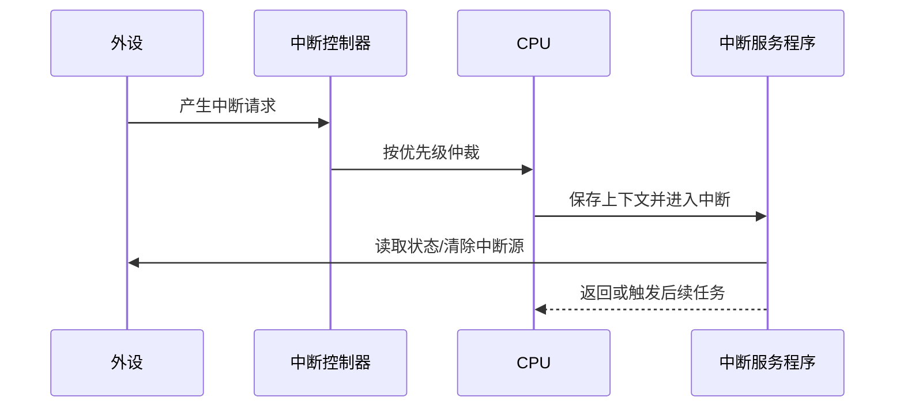

# 硬件中断

硬件中断用于通知处理器某个外设或硬件事件需要服务，例如定时器到期、通信接收完成或 ADC 转换结束。中断号、优先级、向量表和屏蔽机制因处理器而异；IRQ0–IRQ15 只适用于特定历史 PC/兼容架构语境，不是通用嵌入式编号。

## 典型处理流程

## ISR 设计原则

- 保持短小、确定，避免在中断中执行耗时操作。
- 正确清除中断源，避免中断风暴。
- 共享数据需要明确原子性、临界区和内存可见性。
- 避免在 ISR 中调用不可重入或阻塞函数。
- 对嵌套中断、优先级和栈空间做最坏情况分析。
- 将复杂处理移交任务或延迟处理上下文。

## 调试清单

检查向量表、使能位、优先级、屏蔽状态、外设标志位、触发边沿/电平、清除顺序、嵌套配置和 ISR 执行时间。记录触发条件与时间戳，验证中断是否丢失或重复触发。