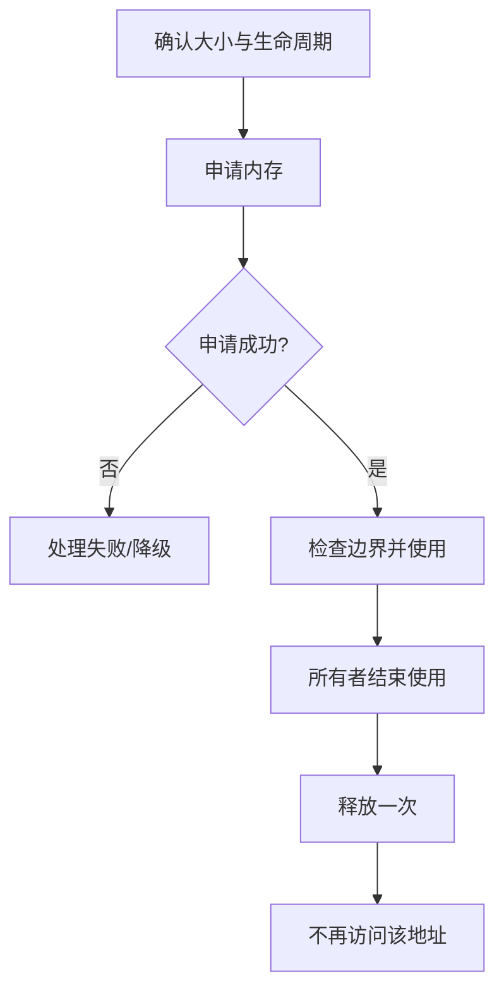

# 堆内存管理：动态分配与释放

堆用于支持运行时动态分配的对象或缓冲区。具体分配器可能使用空闲链表、分区、伙伴系统或专用内存池；嵌入式系统还常限制或禁用通用动态分配，以降低不可预测性。

## 生命周期

## 常见问题

- 内存泄漏：申请后没有在所有路径释放。
- 重复释放：同一块内存被释放多次。
- 悬空指针：释放后仍通过旧指针访问。
- 越界访问：访问范围超出分配大小。
- 碎片化：总空闲量看似足够，但无法满足连续分配请求。
- 分配失败未处理：低内存情况下程序继续使用无效指针。

## C 语言安全检查

- 检查申请结果是否为 NULL。
- 确保大小计算不会发生整数溢出。
- 明确谁拥有内存、谁负责释放。
- 释放后将指针置为 NULL 只能降低部分风险，不能修复其他别名指针。
- 对实时系统评估最坏分配时间和碎片化；固定内存池可能更合适。
- 使用静态分析、地址检查工具或压力测试发现泄漏和越界。
