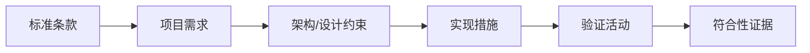

# 汽车电子相关 ISO 标准入口

- [[ISO 26262]]：道路车辆功能安全相关标准系列。
- [[ISO 14229]]：道路车辆统一诊断服务（UDS）相关标准系列。
- [[Standards]]：标准阅读与证据记录方法。
- [[AUTOSAR Stands]]：AUTOSAR 规范入口。

## 使用标准时要注意

标准编号本身不够，还需要记录具体部分、版本/修订年份、适用对象和项目引用要求。不同标准可能分别覆盖功能安全、诊断服务、网络安全、质量管理或测试方法，不能互相替代。

## 标准条款落地流程

每个重要结论应能追溯到条款、项目需求、实现工件和测试结果。正式工程请使用合法获取的标准正文及项目认可版本，不依赖二手摘要替代规范。
