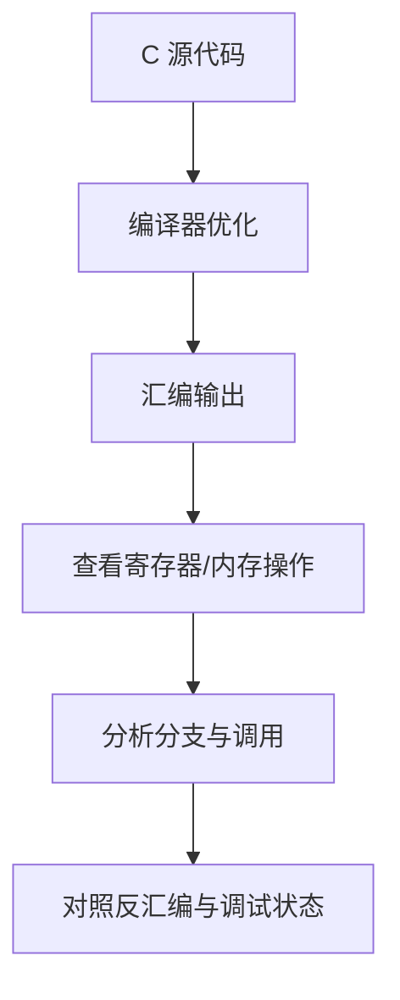

# 汇编指令分类与阅读方法

汇编指令是处理器指令集的可读表示。指令名称、操作数顺序、寻址方式、标志位影响和调用约定都依赖目标 ISA；以下分类用于建立概念，不代表所有指令集都有相同指令。

## 常见类别

- 数据传送：MOV、LOAD/STORE 等。
- 算术运算：ADD、SUB、MUL、DIV 等。
- 逻辑运算：AND、OR、XOR、NOT 等。
- 控制转移：JMP、条件分支、CALL、RET 等。
- 比较与测试：CMP、TEST 等。
- 栈与上下文：PUSH、POP 或架构对应的栈访问指令。
- 特殊指令：中断控制、屏障、原子操作、状态寄存器访问等。

## 从 C 代码理解汇编

## 阅读一段汇编时记录

1. 目标架构、位宽、ABI 和编译选项。
2. 输入参数与返回值如何传递。
3. 哪些寄存器被读写，哪些需要保存。
4. 内存访问地址、宽度、对齐和副作用。
5. 分支条件依赖哪些标志或比较结果。
6. 调用栈与返回地址如何维护。
7. 编译器是否进行了内联、循环展开或其他优化。

建议选择一个简单 C 函数，分别在不同优化等级下生成汇编并比较；用调试器逐条单步验证寄存器与内存变化。