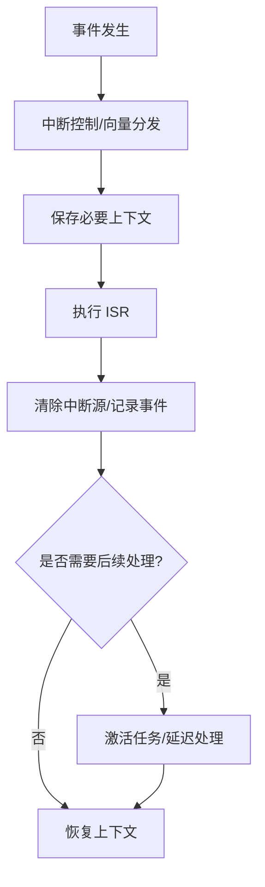

# 中断机制总览

中断让处理器响应外设事件或内部异常，而不必让主程序持续轮询。中断设计需要同时考虑延迟、优先级、共享数据、执行时间和栈占用。

- [[Hardware Interrupts]]：外设或硬件事件触发的中断。
- [[Software Interrupts]]：软件触发的陷阱、系统服务入口等概念。
- [[Registers]]：检查程序计数器、栈指针和状态寄存器。
- [[OS(Operating System)]]：中断与任务调度的关系。

## ISR 设计原则

- 保持中断服务程序短小、可预测，耗时处理尽可能延后到任务上下文。
- 按芯片手册规定清除中断源，避免中断持续触发或丢失事件。
- 明确嵌套优先级、允许嵌套的范围和最大栈深度。
- 共享数据要有明确的同步策略；volatile 不能替代互斥、原子操作或内存屏障。
- 不要在 ISR 中调用可能阻塞、等待调度或不具备中断安全性的 API。

## 关键问题

- 触发类型是边沿还是电平？中断源如何清除？
- 优先级和嵌套规则是什么？
- ISR 是否过长，是否执行阻塞操作？
- 共享变量是否需要原子访问或临界区？
- 最坏嵌套深度是否导致栈溢出？
- 如何测量中断延迟、执行时间和丢失事件？

应以目标处理器和 RTOS 文档为准，不要把一种架构的中断模型套用到所有 MCU。