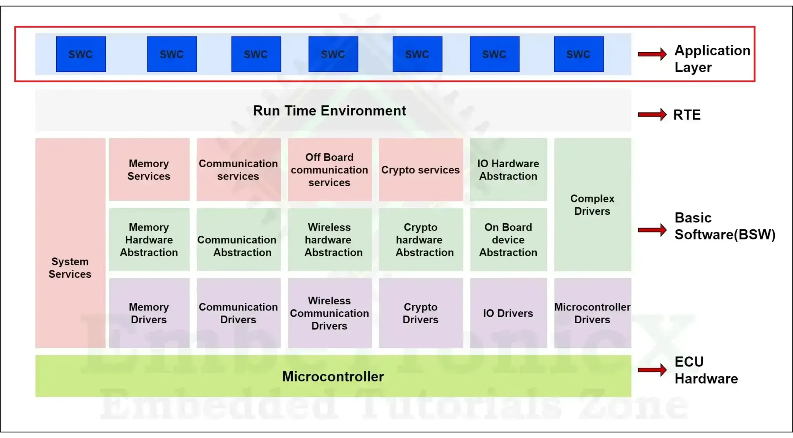
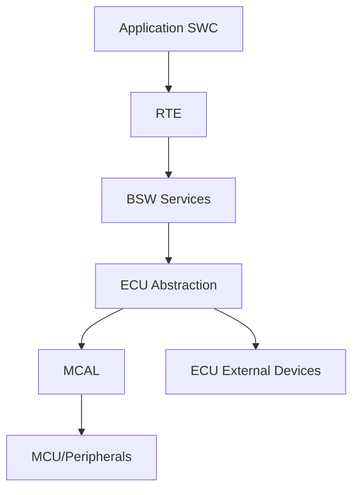

# AUTOSAR Classic Platform 分层

- [[Application Layer]]
- [[Middleware Layer]]
- [[Basic Software Layer]]

在常见的 Classic Platform 概念模型中，应用软件组件通过 RTE 与基础软件交互；BSW 内部又可按服务层、ECU 抽象层、MCAL 等职责划分。某些项目资料会把 RTE 或部分中间服务单独画成 Middleware 层，这属于图示组织方式，阅读时应以标准定义和实际模块边界为准。

## 分层的意义

- **职责隔离**：应用逻辑不直接依赖所有硬件细节。
- **可移植性**：更换硬件或供应商时尽量限制改动范围。
- **配置驱动**：通过系统描述与 ECU 配置生成适配工件。
- **可测试性**：接口边界便于模拟、集成和故障定位。

## 使用这张图时

区分标准中的正式层次、供应商工具的模块分类和项目内部的架构图。每张项目架构图应标明适用平台、版本和图示范围。
