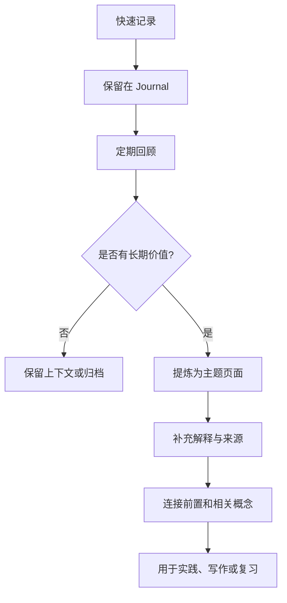

# Logseq 使用指南

> Logseq 是以大纲和双向链接为核心的知识管理工具。本页记录常用操作和可持续维护的工作流；具体快捷键可能因操作系统、版本和用户配置而不同。

## 1. 常用操作

| 任务 | 说明 |
|---|---|
| 创建页面 | 在块中输入页面链接，例如 `[[AUTOSAR]]`，再打开或创建目标页面 |
| 建立关联 | 用页面链接把概念、项目、来源和复盘连接起来 |
| 插入数学公式 | 行内公式使用 `$...$`，块级公式使用 `$$...$$`；需确认当前渲染器支持情况 |
| 换行 | 常见桌面配置中可使用 `Shift+Enter`；若快捷键被自定义，请以设置为准 |
| 创建待办 | 使用 Logseq 支持的 TODO/DONE 状态标记或编辑器菜单 |
| 查看反向链接 | 打开页面后查看引用该页面的块，帮助发现知识连接 |
| 导出/同步 | 先确认同步目标、冲突处理和备份策略，再操作重要图谱 |

## 2. 推荐的日常工作流

## 3. 页面与块如何分工

- **Journal（日记）**：记录发生时间、工作上下文、临时想法和待办。
- **主题页面**：解释相对稳定的概念，尽量做到脱离原始上下文仍可理解。
- **项目页面**：管理目标、决策、任务、风险和阶段性结果。
- **来源页面**：保存书籍、文章、标准或视频的书目信息和自己的摘要。
- **白板**：适合探索空间关系与临时建模；重要结论应整理成可检索的主题页面。

## 4. 备份与安全

- 同步不是备份：同步可能把误删或错误修改传播到其他设备。
- 大规模整理前，先确认图谱目录、版本控制和恢复方式。
- 不要把访问令牌、密码、私密日记或项目机密发布到公开仓库。
- 对插件和主题配置，记录版本与用途；升级前确认兼容性并保留可恢复副本。

## 5. 常见问题排查

- **页面链接没有打开目标页**：检查页面名拼写、空格和链接语法。
- **图片无法显示**：确认资源路径、文件是否提交、大小写是否一致。
- **数学公式显示异常**：检查定界符、转义字符和当前渲染环境。
- **同步冲突**：先保留冲突副本，比较修改时间与内容，不要直接覆盖唯一副本。
- **插件异常**：先确认版本兼容性，再逐个禁用或更新插件，避免一次更改多个变量。

## 6. 官方资料

- [Logseq 官方网站](https://logseq.com/)
- [Logseq Sync 使用说明](https://blog.logseq.com/how-to-setup-and-use-logseq-sync/)

使用在线文档时应注意产品版本变化。若快捷键或菜单名称与当前版本不一致，以应用内设置和官方文档为准。

## 7. 相关笔记

- [[知识管理]]
- [[笔记管理]]
- [[卡片笔记]]
- [[笔记编写规范]]
- [[打造第二大脑]]
- [[阅读管理]]