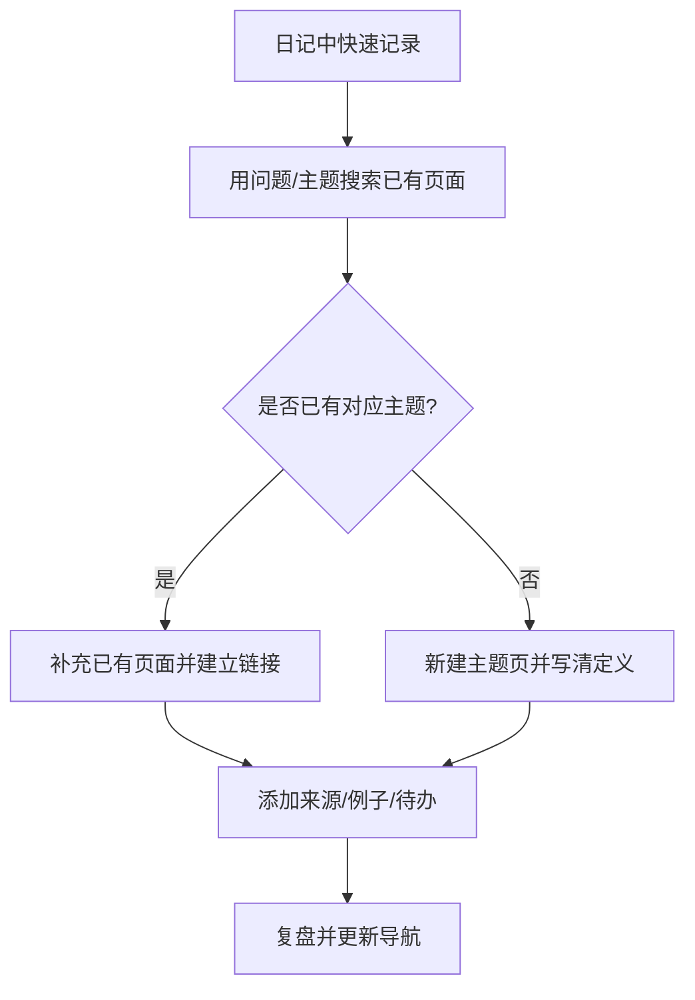

# Logseq 使用指南

Logseq 是以块、页面、日记和双向链接为核心的知识管理工具。本仓库使用 Markdown 页面与日记保存知识；操作细节可能随 Logseq 版本变化，快捷键以当前应用设置为准。

## 常用操作

- **换行**：在块内使用 Shift+Enter（具体行为以版本与快捷键设置为准）。
- **待办**：可通过快捷键或块类型菜单将块设为 TODO / DOING / DONE。
- **页面链接**：输入 `[[页面名称]]` 建立内部链接。
- **块引用**：需要引用具体段落时使用块引用，而不是复制多份正文。
- **数学公式**：行内公式可使用 LaTeX 定界符；独立公式使用双美元符号，例如 `$$a^2+b^2=c^2$$`。
- **属性与标签**：用于记录状态、来源、类型等可检索信息，避免无目的地创建大量标签。

## 推荐工作流

## 维护与备份

- 定期提交 Git 变更，使用差异查看意外删除或大段改写。
- 同步前后检查冲突，重要修改前先备份。
- 不要手动编辑插件标记为自动生成的数据文件，例如 Excalidraw 插件库存储页。
- 迁移前先抽样导出，检查中文、附件、图片、链接与属性是否完整。

官方入口：[Logseq](https://logseq.com/)；同步说明：[How to set up and use Logseq Sync](https://blog.logseq.com/how-to-setup-and-use-logseq-sync/)。