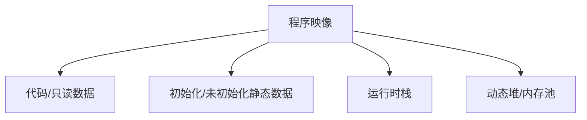

# 内存管理：栈、堆与静态区

程序内存通常可以从代码/只读数据、静态存储区、栈和堆等角度理解。实际地址布局由目标架构、链接脚本、运行库和操作系统/RTOS 决定。

- [[Stack Operations]]：函数调用、局部变量和上下文保存。
- [[Heap Management]]：动态分配、释放与碎片化。
- [[Registers]]：栈指针、程序计数器和调试状态。
- [[C语言]]：对象生命周期、作用域与指针。

## 内存区域概念图

## 典型故障

- 栈溢出：递归过深、局部变量过大或中断嵌套。
- 堆泄漏/碎片化：分配与释放模式不合理。
- 越界读写：破坏邻近对象、返回地址或控制数据。
- 生命周期错误：使用已释放或已离开作用域的对象。
- 对齐/地址错误：访问方式不满足目标架构要求。

## 调试建议

结合链接映射、栈水位、内存保护配置、静态分析和运行日志定位。对实时系统还应关注最坏内存需求和分配时间，必要时优先采用固定大小内存池。
