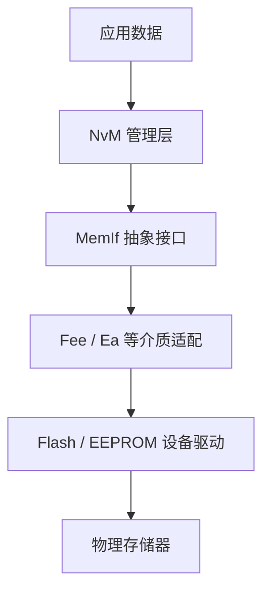

# 非易失性存储（NVM）知识入口

非易失性存储用于在断电后保留数据。嵌入式项目中要区分芯片物理存储介质、驱动/抽象层和上层数据管理服务。

- [[NVRAM]]：在 AUTOSAR 语境中常指由 NvM 等软件管理的非易失性数据抽象；不一定对应单一物理芯片。
- [[EEPROM]]：可电擦写的非易失性存储介质/器件类别。
- 相关概念：Flash、RAM 镜像、数据块、CRC、冗余、默认值、写入磨损和掉电一致性。

该图是常见 AUTOSAR Classic 存储路径的概念示意，实际模块和介质适配取决于项目配置与供应商实现。

## 设计与调试要点

- 明确数据生命周期：何时初始化、读取、修改、写入和恢复默认值。
- 区分 RAM 当前值与非易失性持久化值，确认写入完成条件。
- 检查块大小、对齐、CRC、冗余、校验策略和错误回调。
- 评估写入频率与介质寿命，避免周期性无条件写入。
- 测试掉电、写入中断、数据损坏、版本升级和旧数据迁移。
- 通过 API 返回值、状态回调、驱动日志和存储内容交叉验证。
