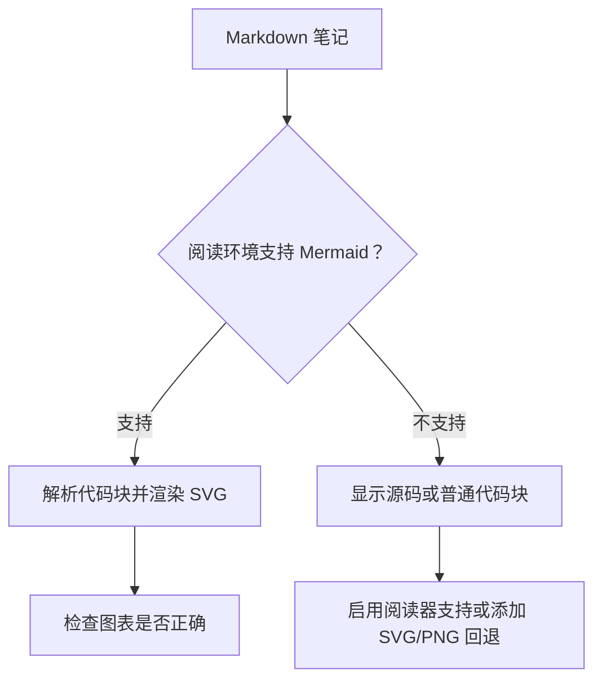
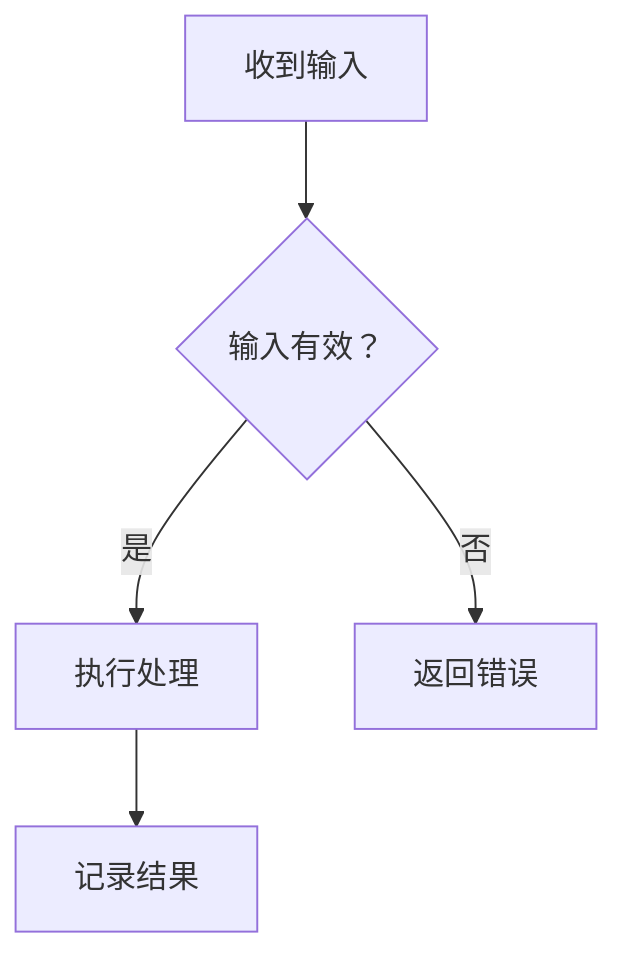
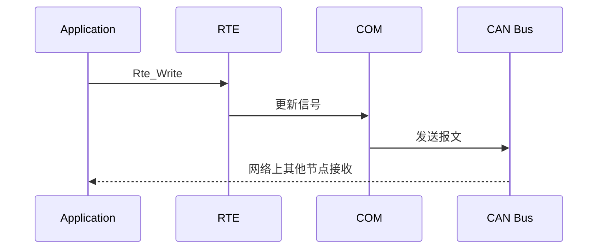
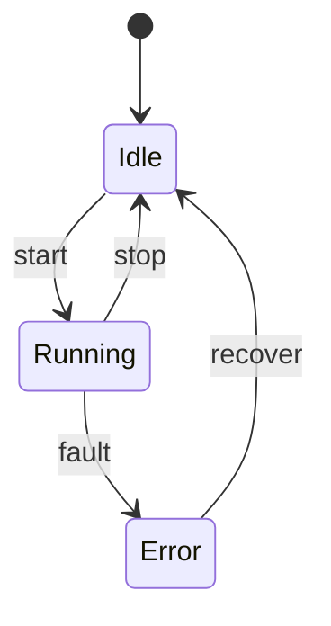
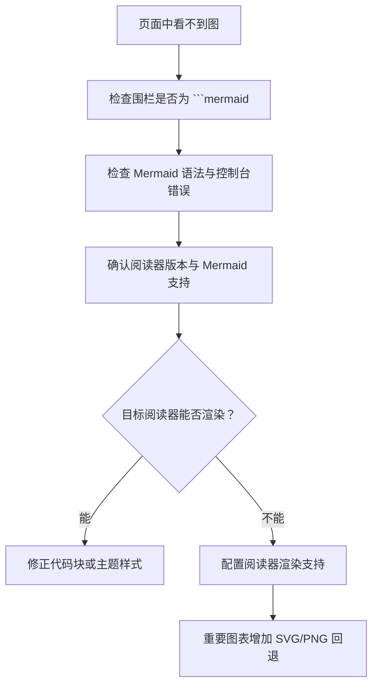

# Mermaid 图表渲染与维护指南

> 本页说明如何在 Notes 知识库中编写 Mermaid 图表、确认渲染能力，以及在阅读器不支持时提供可靠回退。

## 1. 先明确渲染发生在哪里

Mermaid 源码本身是文本，只有阅读器或发布站点加载并启用 Mermaid 解析器后，才会显示为图形。



- **GitHub：** 支持将符合格式的 Mermaid 代码围栏渲染为图表。
- **Logseq：** 在实际使用的 Logseq 版本中，用 `mermaid` 语言标记的代码块测试原生渲染。
- **其他发布站点或 Markdown 阅读器：** 需确认其是否启用了 Mermaid。仅在笔记里写入 Mermaid 源码，不能自动为不支持 Mermaid 的站点增加渲染能力。
- **SVG/PNG：** 作为兼容性回退；保留 Mermaid 源码，便于后续编辑和版本管理。

## 2. 标准写法

Mermaid 图必须使用独立的三反引号围栏，并将语言标识写为小写的 `mermaid`。围栏前后都要留出清晰的段落边界。

```markdown
文字说明：下面展示模块之间的调用顺序。


图后补充关键节点的含义、适用边界和需要读者注意的结论。
```

注意：上面的 Markdown 模板展示的是围栏写法；实际笔记中的 Mermaid 代码块内部不要再套一层 `markdown` 围栏。

## 3. 常用图表类型

### 流程图：描述步骤、分支与异常路径



### 时序图：描述组件之间的调用顺序



### 状态图：描述状态与转换条件



## 4. 编写约定

1. **先有解释，再有图。** 图表必须服务于一个具体问题，避免只堆节点。
2. **节点命名简洁。** 长说明放在正文，节点中保留关键词。
3. **优先使用常见语法。** 对兼容性要求高的图，优先采用 `flowchart`、`sequenceDiagram` 和 `stateDiagram-v2`。
4. **避免容易触发解析问题的文本。** 复杂标点、未闭合引号、HTML 标签和过长节点应简化；必要时用引号包住节点文本。
5. **每张图只表达一个层次。** 大型架构图拆成总览图与局部细节图。
6. **图文保持一致。** 修改流程或接口后，检查图、正文和代码是否同步。
7. **记录适用范围。** 工程图注明版本、项目差异和验证状态，避免把示意图误当作标准强制要求。

## 5. 不渲染时按顺序排查



- 确认起始围栏是 ```mermaid，结束围栏是单独一行的三个反引号。
- 在 GitHub 文件页面检查同一段源码是否能渲染，以区分源码语法问题与目标站点运行时问题。
- 在目标站点打开浏览器开发者工具，检查 Console 中的解析错误，以及 Network 中 Mermaid 脚本是否加载失败。
- 若代码块只显示为普通文本，通常说明阅读器没有处理 Mermaid 代码块，或相关脚本未成功初始化。
- 如果 GitHub 能渲染而个人站点不能渲染，应检查个人站点的构建器/前端渲染配置；不要仅靠修改笔记文本来推断站点已修复。

## 6. SVG/PNG 回退策略

对学习首页、关键架构、关键流程等重要图示，建议同时维护：

- 可编辑的 Mermaid 源码；
- 必要时导出的 SVG/PNG；
- 对图示的简短文字说明。

例如：

```markdown


```

路径应相对于当前 Markdown 文件，并在提交前确认资源真实存在。回退图片应由同一份逻辑生成或人工同步维护，避免图文版本不一致。

## 7. 发布前检查清单

- [ ] Mermaid 使用独立的 `mermaid` 代码围栏。
- [ ] 图表语法闭合，节点和连线含义明确。
- [ ] 目标阅读器已实际验证，不以源码存在代替渲染验证。
- [ ] 关键图表在不支持 Mermaid 的环境下有文字或图片回退。
- [ ] 图片路径有效，SVG/PNG 与源码表达一致。
- [ ] 发布后检查目标站点，而不只检查 GitHub 仓库页面。

## 相关页面

- [笔记编写规范](笔记编写规范.md)
- [知识库导航](知识库导航.md)
- [知识库全量完善计划](知识库全量完善计划.md)
