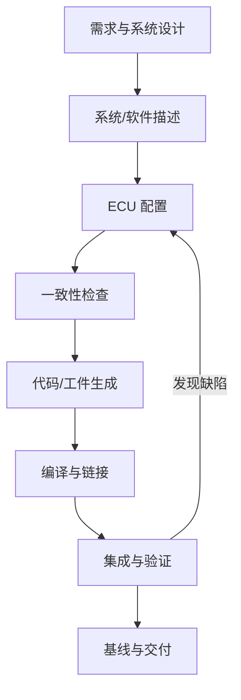

# AUTOSAR 工程方法学

AUTOSAR 工程方法学帮助团队把需求、系统描述、软件组件、ECU 配置、生成工件、集成与验证组织成可追溯流程。工具操作顺序和工件格式会因工具链及项目裁剪而不同。

- [[Configuration]]：配置模型、参数与变体处理。
- [[Development Process]]：需求到验证的开发流程。
- [[Standards]]：标准条款与项目证据。
- [[Tools]]：配置、开发、测试和监控工具。

## 方法学中的关键问题

1. 每个输入工件是否有版本和责任人？
2. 配置模型、工具版本和生成参数是否可追溯？
3. 生成结果是否可重复，变更是否有审查记录？
4. 需求、配置、代码和测试之间是否建立追踪关系？
5. 验证失败时是否能定位到变更、配置或接口差异？

把流程写成团队可执行的检查表，并保留失败和返工记录，通常比只保留流程图更有价值。
