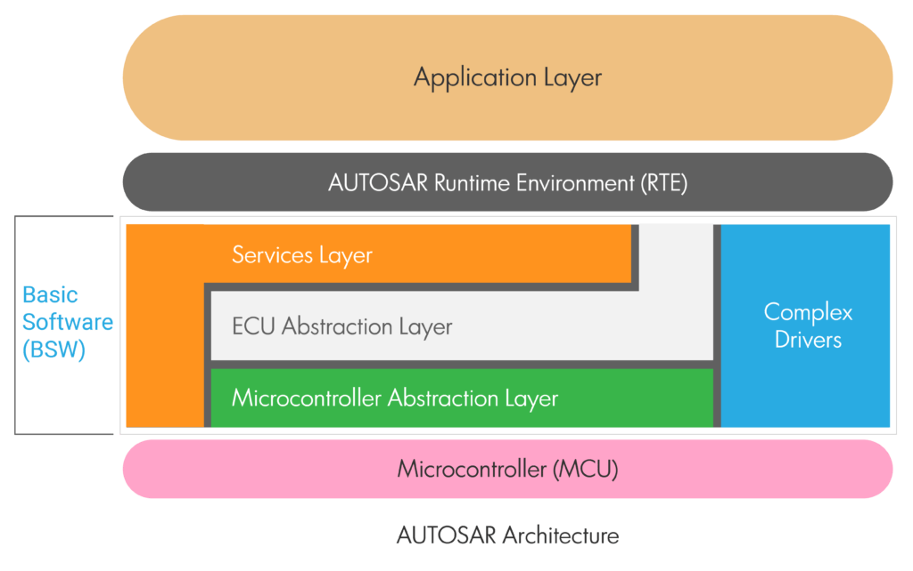
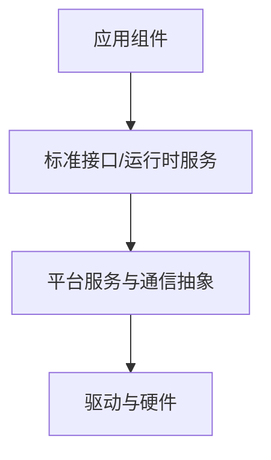

# 中间层与运行时服务

“中间层”在不同架构图中可能有不同含义。在 AUTOSAR Classic 项目中，应明确它指的是 RTE、服务接口、通信抽象，还是项目内部定义的其他软件层；不要仅凭图示名称认定它是标准中的独立层。

## 中间层通常解决的问题

- 隔离应用与底层实现细节。
- 提供统一接口和数据传递机制。
- 管理服务访问、消息路由、生命周期或资源。
- 帮助不同组件独立开发和测试。

## 架构关系示意

## 设计检查

- 接口契约是否明确，包括数据格式、时序、错误和资源所有权？
- 中间层是否引入不必要的拷贝、延迟或复杂依赖？
- 服务调用是否有超时、错误传播和资源限制？
- 模块边界是否便于模拟测试和替换实现？
- 图中的每一层是否对应可识别的模块、接口或责任？

在工程文档中，应使用项目真实的模块名称，并标注平台、版本和图示范围。
