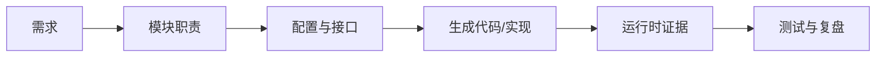

# AUTOSAR 模块索引

模块索引应帮助回答三个问题：模块负责什么、与谁交互、问题出现时应该检查哪些证据。具体模块集合和命名可能因平台、版本与供应商实现而变化。

- [[Memory]]：非易失性数据与存储访问
- [[Safety]]：安全相关约束与工程实践入口
- [[Security]]：安全访问、密钥与通信保护等主题入口
- [[Communication]]：总线与通信协议
- [[System]]：系统服务、状态、初始化和运行时管理
- [[Basic Software]]：BSW 分层与服务
- [[Diagnostic Stack]]：诊断请求与响应路径
- [[Communication Stack]]：信号/PDU 到总线的链路

## 模块笔记推荐结构

| 字段 | 记录内容 |
|---|---|
| 职责 | 模块解决的问题与不负责的范围 |
| 输入/输出 | API、回调、数据结构、状态和错误码 |
| 依赖 | 上游调用者、下游模块、初始化前置条件 |
| 配置 | 关键参数、合法值、约束和变体条件 |
| 运行机制 | 状态机、任务/中断上下文、时序 |
| 故障表现 | 日志、返回值、测量信号和常见根因 |
| 验证 | 单元测试、集成测试、故障注入与回归 |
| 来源 | 标准版本、供应商文档、项目需求和代码位置 |

