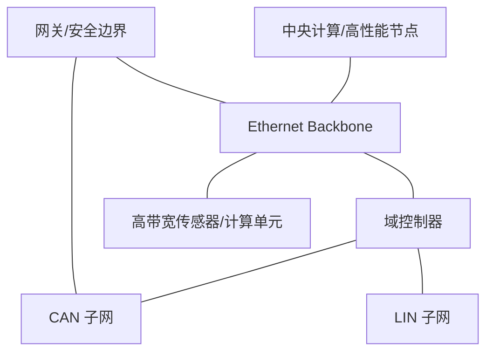

# 车载网络架构

车载网络架构描述 ECU、域控制器、中央计算节点、网关和车载总线之间的连接方式，以及数据如何跨网络传输。网络拓扑需要同时满足带宽、实时性、隔离、安全、故障影响范围和成本要求。

- [[Ethernet]]
- [[Bus System]]
- [[ECU Hardware]]
- [[电子电气架构]]
- [[Communication]]

该图是概念示意，并非特定车型的真实网络图。实际架构应标出节点、总线类型、网关策略、报文/服务路径和关键带宽需求。

## 评审维度

- 通信需求：周期、载荷、峰值带宽和端到端延迟。
- 可靠性：链路冗余、故障检测、降级和恢复机制。
- 安全：网络分区、访问控制、诊断权限和安全更新。
- 可维护性：拓扑文档、地址/标识规划、日志和测试接口。
- 验证：负载测试、故障注入、丢包/延迟测量和安全测试。
