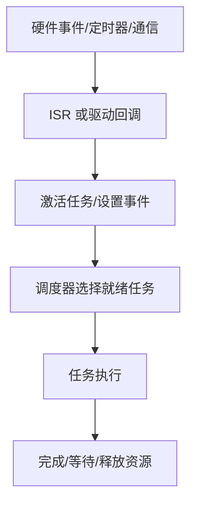

# 嵌入式操作系统与实时调度

嵌入式操作系统负责任务/中断调度、同步、时间管理和资源协调。汽车项目中常见 OSEK/VDX 与 AUTOSAR OS 相关概念，但具体服务、合规等级和实现能力应按项目标准与供应商手册确认。

- [[OSEK/VDX]]
- [[AUTOSAR OS]]
- 相关主题：任务、优先级、抢占、ISR、事件、资源、计数器、Alarm、Schedule Table、看门狗和时间保护。

## 从事件到任务

## 时序术语

- **周期**：任务预期多久执行一次。
- **截止时间**：任务结果最晚需要完成的时间。
- **执行时间**：任务实际占用 CPU 的时间，应通过分析或测量获得。
- **响应时间**：从事件发生到任务完成的时间。
- **抖动**：实际执行时刻相对目标时刻的偏差。
- **WCET**：在明确假设和分析范围内的最坏情况执行时间上界。
- **优先级反转**：高优先级任务等待低优先级任务持有的资源。

## 调度与同步的常见风险

- 高优先级任务执行过久，导致低优先级任务饥饿。
- 共享资源使用不当造成死锁或优先级反转。
- 临界区过长，增加中断延迟。
- 栈预算不足，导致任务或中断上下文溢出。
- 周期任务负载过高，无法在截止时间前完成。

## 调试清单

1. 任务是否被激活？激活条件是否正确？
2. 优先级、抢占属性和调度策略是否符合设计？
3. 是否存在死锁、优先级反转或长时间关中断？
4. 栈空间是否充足？是否有递归、深层调用或大局部变量？
5. 共享数据是否需要临界区、原子操作或消息传递？
6. 通过时间戳、运行时测量和负载统计验证周期、响应时间和抖动。

## 实践练习

实现两个周期任务和一个事件任务，记录计划触发时间、实际开始时间、执行时长与完成时间；再注入高负载和资源竞争，比较优化前后的时序表现。