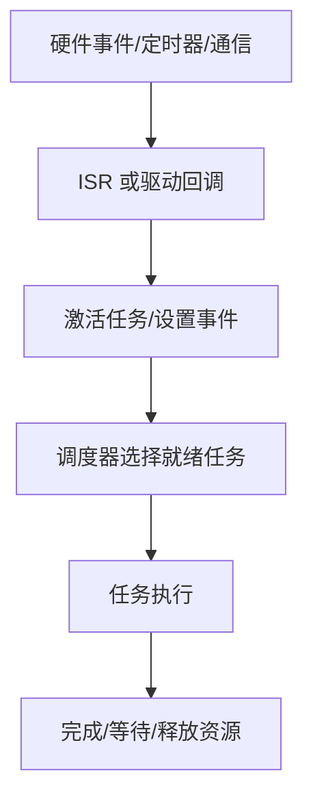

# 嵌入式操作系统与实时调度

嵌入式操作系统负责任务/中断调度、同步、时间管理和资源协调。汽车项目中常见 OSEK/VDX 与 AUTOSAR OS 相关概念，但具体服务、合规等级和实现能力应按项目标准与供应商手册确认。

- [[OSEK/VDX]]
- [[AUTOSAR OS]]
- 相关主题：任务、优先级、抢占、ISR、事件、资源、计数器、Alarm、Schedule Table、看门狗和时间保护。

## 从事件到任务

## 必须理解的时序概念

- 周期：任务预期多久执行一次。
- 截止时间：任务结果最晚需要完成的时间。
- 执行时间：任务实际占用 CPU 的时间，需测量或分析。
- 抖动：执行时刻相对目标时刻的偏差。
- 优先级反转：高优先级任务等待被低优先级任务持有的资源。
- 最坏情况执行时间（WCET）：在指定假设下的执行时间上界。

## 调试清单

1. 任务是否被激活？激活条件是否正确？
2. 优先级、抢占属性和调度策略是否符合设计？
3. 是否存在死锁、优先级反转或长时间关中断？
4. 栈空间是否充足？是否有递归、深层调用或大局部变量？
5. 共享数据是否需要临界区、原子操作或消息传递？
6. 通过时间戳、运行时测量和负载统计验证周期、响应时间和抖动。

## 实践练习

实现两个周期任务和一个事件任务，记录计划触发时间、实际开始时间、执行时长与完成时间；注入高负载和资源竞争，比较优化前后的时序表现。
