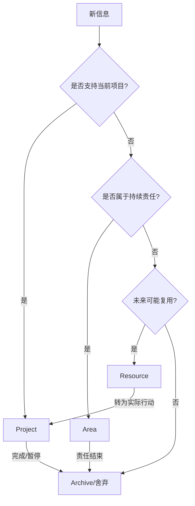

# PARA：以行动和使用场景组织信息

PARA 将数字信息按与当前行动的关系分为 Projects、Areas、Resources、Archives 四类。它解决的是“资料放在哪里、什么时候需要回看”，不替代主题笔记内部的知识结构。

- 方法技巧：https://workflowy.com/systems/para-method/
- 参考案例：
  - https://leon21.notion.site/PARA-ceae6018654a4496854e51151cf57acf
  - https://www.fufusee.com/blog/secondbrain-03
  - https://fm-chen.tw/post/para-method/
  - https://www.cnblogs.com/luchaoshuai/p/18064969
  - https://waynerv.com/posts/reading-notes-of-building-a-second-brain/

## 四类信息

- [[Project]]（项目）：有明确目标、截止条件和可验收结果的工作。
- [[Area]]（领域）：需要持续维护的责任，如健康、职业、财务或某项长期技能。
- [[Resource]]（资源）：未来可能用到的主题、参考资料和兴趣方向。
- [[Archive]]（归档）：已完成、不再活跃或暂时不需要的项目与资料。

## 使用原则

1. 先按行动情境决定归属，再用主题标签和双向链接建立跨领域关系。
2. 项目必须有完成定义；若没有结束条件，可能更适合归为 Area。
3. 资源不需要全部精加工；只有被项目调用或有长期价值时再深化。
4. 归档意味着退出当前工作视野，不等于删除。
5. 定期审查项目是否已完成、领域是否需要维护、资源是否仍有价值。

## 常见误区

- 把 PARA 当成严格的知识分类学：同一主题可以在多个项目中被链接使用。
- 只整理文件夹而不建立行动：整理必须服务于检索、决策和交付。
- 把所有收藏都视为资源：保存成本与未来使用价值应当匹配。
- 不敢归档：归档的目的正是降低当前视野中的噪声。

我的 PARA 系统分类：[[Project]]、[[Area]]、[[Resource]]、[[Archive]]。
