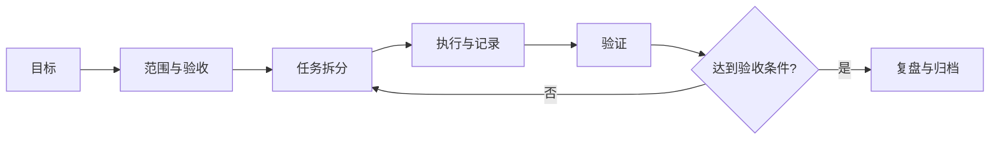

# 项目管理与工程知识

项目笔记用于保留目标、约束、决策、行动和结果，使未来能够理解“为什么这样做”，而不仅仅是“做过什么”。

- [[工作管理]]
- [[笔记管理]]
- [[学习管理]]
- [[PARA]]

## 项目首页建议结构

- **目标与验收条件**：什么状态才算完成？
- **范围与非目标**：本轮包含什么、不包含什么？
- **里程碑**：每个阶段的可验证交付物。
- **决策记录**：选项、理由、影响、日期和责任人。
- **风险与依赖**：发生概率、影响、应对措施和触发信号。
- **行动列表**：下一步、负责人、截止时间、完成定义。
- **证据链接**：代码提交、测试结果、会议纪要、设计图和发布记录。

## 每周复盘

- 本周完成了哪些可验证成果？
- 哪些假设被证实或推翻？
- 最大阻塞是什么，根因是什么？
- 哪些任务应停止、延后或委派？
- 下周最重要的一个交付物是什么？
