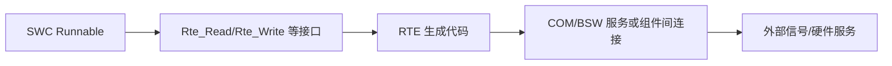

# 运行时环境与 RTE

运行时环境（Runtime Environment, RTE）在 AUTOSAR Classic 中为软件组件提供通信和访问机制，把 SWC 接口与具体 ECU 软件实现连接起来。实际生成的 API 和运行时机制取决于组件描述、系统映射、配置工具和所采用的版本。

- [[OS(Operating System)]]：任务、事件和运行上下文。
- [[ECU Abstraction]]：硬件访问抽象。
- [[AUTOSAR]]：整体架构入口。
- [[Configuration]]：配置模型与代码生成。

## 数据流示意

这是一种概念级数据流；具体接口名称、调用方式和下游路径需查看项目生成的 RTE 头文件、实现文件与配置描述。

## RTE 问题定位

1. 检查 SWC Port、Interface、Data Element 和 Runnable 访问声明。
2. 检查连接器、系统映射、任务映射与事件配置。
3. 确认生成代码和配置输入来自同一基线。
4. 检查调用上下文、数据更新周期、返回状态和初始化顺序。
5. 对照实际生成的 Rte_* API、任务代码和运行日志进行验证。
