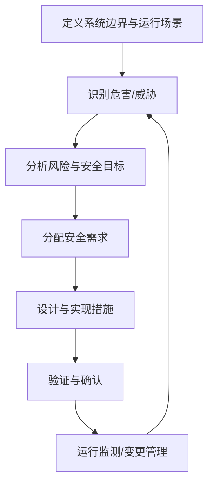

# 汽车电子安全工程入口

汽车电子安全涉及功能安全、网络安全和系统可靠性等不同问题。它们相关但并不等同：功能安全关注系统故障导致的危险风险，网络安全关注恶意行为和攻击面，可靠性关注系统在规定条件下持续正确工作的能力。

- [[ISO Standards]]
- [[ISO 26262]]
- [[End-to-End Protection]]
- [[Safety Management]]
- [[Security]]

## 安全工程闭环

## 工程实践要点

- 安全需求必须可追踪到架构、实现和验证活动。
- 失效模式、诊断覆盖、故障反应和降级策略需要明确。
- 安全机制自身也可能失效，应考虑共因失效与依赖关系。
- 对安全相关变更进行影响分析，并保留评审与测试证据。
- 术语、流程和合规结论应以项目适用的标准版本及组织流程为准。

此页是知识入口，不替代标准正文、安全计划或项目安全案例。
