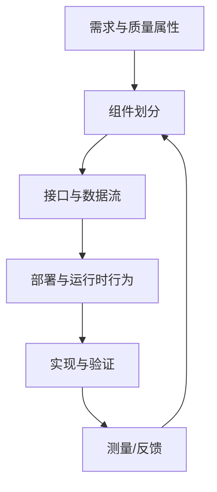

# 软件架构

软件架构定义系统的软件组件、职责、接口、依赖关系、部署方式和关键质量属性。好的架构不仅描述模块如何连接，还要解释为什么这样分解，以及如何验证性能、可靠性和可维护性目标。

- [[Basic Software]]：平台基础服务与驱动层。
- [[Runtime Environment]]：应用组件与运行时服务之间的连接。
- [[架构设计]]：架构决策与设计原则。
- [[Development Process]]：需求、设计、实现和验证的生命周期。

## 架构评审清单

1. 组件职责是否清楚，是否存在重复职责或过大的模块？
2. 接口是否定义数据、时序、错误、资源和兼容性要求？
3. 依赖方向是否可控，是否有循环依赖？
4. 启动、异常、通信中断和资源耗尽时的行为是否明确？
5. 如何证明质量属性满足要求？需要哪些测量和测试？
6. 架构决策、假设、风险和未决问题是否有记录？

不要把供应商模块图直接当成项目软件架构；应根据真实组件、接口和部署关系建立项目视图。
