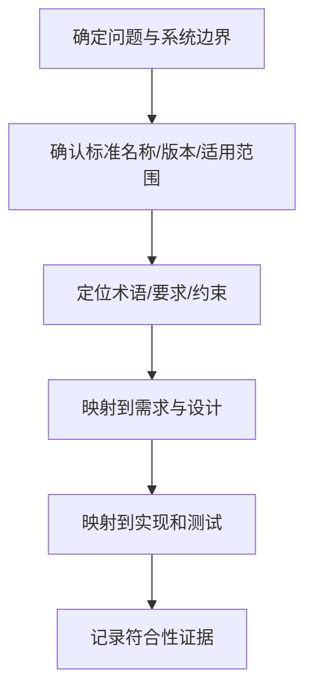

# 标准与规范管理

标准用于统一术语、接口、流程和验证要求，但任何标准条款都需要结合适用范围、版本和项目约束理解。

- [[ISO Standards]]：ISO 体系及相关标准入口
- [[AUTOSAR Stands]]：汽车软件架构规范入口
- [[Safety]]、[[Security]]：安全相关工程要求入口

## 阅读标准的流程

## 标准条款记录模板

- 标准名称与版本：
- 条款编号：
- 适用范围：
- 原始要求（简述，保留必要引用）：
- 项目解释：
- 对应需求/设计/代码：
- 验证方法与结果：
- 偏差、豁免或待澄清问题：

不要只写“符合标准”。应记录如何验证、证据存放在哪里，以及结论适用于哪个版本和配置。
