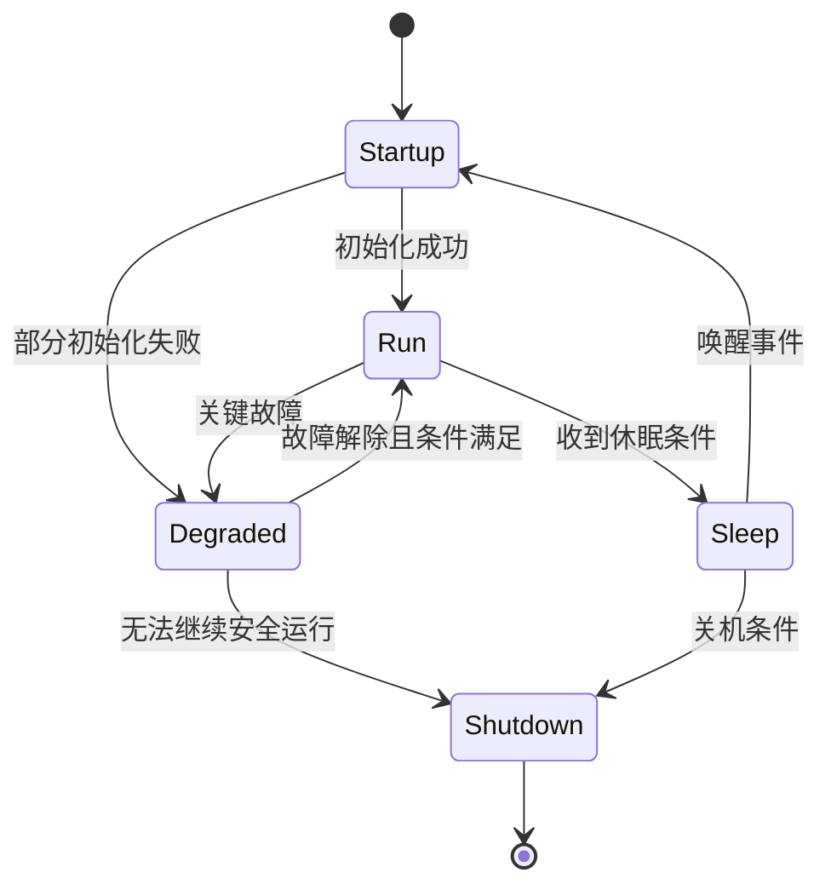

# AUTOSAR 系统服务与状态管理

系统服务负责支撑 ECU 的启动、运行模式、时间管理、看门狗、故障事件和其他跨模块能力。不同项目的模块组合与实现细节存在差异，应按项目架构和配置核实。

- [[OS(Operating System)]]：任务、中断、同步与时间调度
- [[ECU State Manager]]：ECU 状态与模式转换
- [[Watchdog Manager]]：监督程序执行与看门狗触发条件
- [[Diagnostic Event Manager]]：诊断事件与故障信息管理
- [[Basic Software]]：BSW 服务整体架构

## 状态管理的思考模型

该状态图是用于分析的通用示例，不代表某一 AUTOSAR 模块的标准状态机。

## 调试问题

- 启动卡住：核对初始化依赖、调用顺序、任务启动与错误返回。
- 无法休眠：检查唤醒源、通信状态、网络管理与未完成任务。
- 看门狗复位：确认监督配置、任务检查点、执行时间和复位原因寄存器。
- 故障状态不一致：核对事件去抖、故障确认、存储策略和状态转换条件。

对每个状态转换，明确触发事件、守卫条件、动作、超时行为、错误路径和测试方法。
