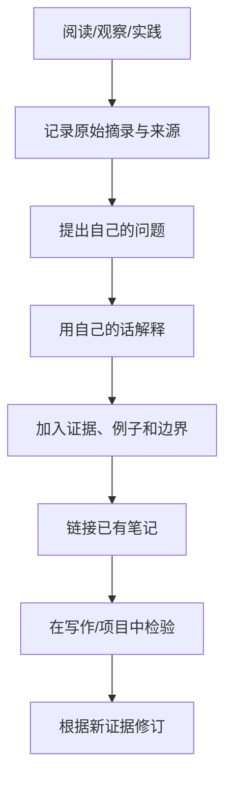

# 卡片笔记学习

卡片笔记的目标不是把资料缩短，而是把一个值得保留的想法写成未来可以独立理解、检索和连接的知识单元。

## 一张卡片的基本结构

- **标题**：表达明确判断或问题，而不只是宽泛主题。
- **核心观点**：用自己的话写出一个可讨论的主张。
- **解释**：说明理由、机制或推导过程。
- **证据/例子**：给出来源、数据、案例或可复现的实践。
- **边界**：说明结论在什么条件下成立、可能在哪些情形失效。
- **链接**：连接前置概念、支持观点、反例和应用场景。
- **下一步问题**：记录尚未解决的问题。

## 从摘录到卡片



## 卡片模板

```markdown
# 一个可检验的观点标题

## 核心观点
用自己的话写清楚一个观点。

## 为什么
解释机制、原因或推理。

## 例子与证据
- 例子：
- 来源/链接：
- 验证方式：

## 边界与反例
哪些条件会改变结论？

## 关联
- 前置知识：[[...]]
- 相关观点：[[...]]
- 应用场景：[[...]]

## 待解决问题
- ...
```

不要为了“卡片化”而把每段文字切得过碎。若一页仍能围绕一个核心问题完整解释，可以保留为一篇主题笔记。