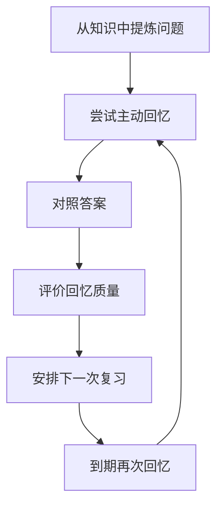

# SuperMemo 与间隔复习

> SuperMemo 是长期研究间隔复习的学习系统之一。其核心启发是：复习应当围绕主动回忆和记忆保持来设计，而不是只反复重读材料。不同版本的算法、界面和工作流存在差异，具体行为应以对应版本文档为准。

## 1. 间隔复习的基本闭环

有效卡片应当聚焦一个明确问题，并能让学习者判断自己是否答对。过长、含糊或一次要求记忆多个无关事实的卡片，通常需要拆分或重写。

## 2. 卡片设计原则

- **问题明确**：避免“解释所有相关内容”这种边界不清的提示。
- **答案可判定**：关键点明确，便于复习时自我评价。
- **上下文足够**：脱离原文后仍能理解问题，但不复制整篇资料。
- **来源可追溯**：记录原始书籍、文章、标准或实践案例。
- **关联可导航**：链接到主题笔记，让卡片能回到完整知识上下文。

## 3. 复习质量的改进方式

1. 先独立回忆，再查看答案。
2. 根据实际回忆质量评价，不要为了“保持连续正确”而虚报成绩。
3. 回忆失败时，检查卡片是否过难、表述是否含糊、前置知识是否缺失。
4. 将容易混淆的概念改写为对比卡片或增加反例。
5. 定期删除重复卡片前先确认是否存在不同语境或不同学习目标。

## 4. SuperMemo 资源

- [SuperMemo 18 中文懒人包](https://github.com/L-M-Sherlock/sm18-lazy-package)
- [awesome-supermemo 资源清单](https://github.com/supermemo/awesome-supermemo)
- [SMDoc-CN 中文文档](https://github.com/Quorafind/SMDoc-CN/tree/master)

这些链接保留为原有学习资源入口。第三方项目可能停止维护，使用前应检查最近更新时间、适用版本和安全性。

## 5. 与其他复习系统的关系

间隔复习是一种学习策略；具体软件会采用不同的调度算法和交互方式。比较系统时，应关注复习记录是否可导出、卡片是否可迁移、算法是否透明，以及是否能与个人知识库连接，而不只比较某一个间隔数字。

## 6. 相关笔记

- [[记忆技巧]]
- [[卡片笔记]]
- [[学习策略]]
- [[阅读管理]]
- [[笔记软件]]