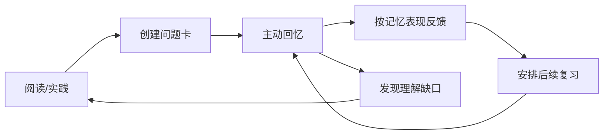

# SuperMemo 与间隔复习

SuperMemo 是一类以间隔重复为核心的学习工具与算法体系。其主要价值在于根据记忆表现安排复习，而不是要求每天机械地重复所有内容。不同版本和算法的细节并不完全相同。

## 复习卡片的设计

- **提示清楚**：一个问题尽量测试一个关键知识点。
- **答案可判断**：避免“谈谈某主题”这类范围过大的提示。
- **理解优先**：对复杂原理可以拆成定义、机制、例子和边界问题。
- **保留上下文**：对标准、工程结论或引用，保留来源与版本。
- **持续维护**：发现卡片含糊、答案过长或已经过时，应重写或暂停复习。

## 复习闭环

## 与本知识库配合

主题页面用于解释完整概念、示例和边界；闪卡用于检验能否主动回忆关键内容。不要把整篇文章原样塞进一张卡片，也不要只依赖熟悉感判断掌握程度。

## 资料入口

- [SuperMemo 18 中文懒人包](https://github.com/L-M-Sherlock/sm18-lazy-package)
- [awesome-supermemo](https://github.com/supermemo/awesome-supermemo)
- [SMDoc-CN 中文文档](https://github.com/Quorafind/SMDoc-CN)

上述链接为社区资源，使用前请核对当前版本、维护状态与适用范围。