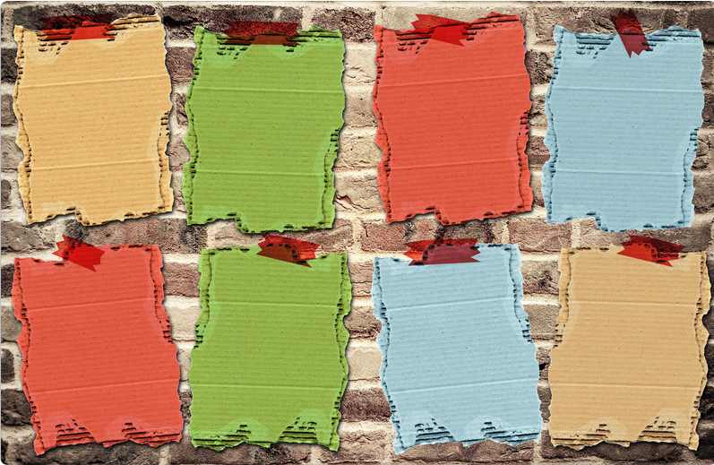

# 个人主页与知识入口管理

- 个人主页 / 知识库：https://likui.space/
- PARA 组织方式：[[PARA]]

主页的价值是降低下一步行动的选择成本，而不是展示所有内容。建议让入口围绕“正在做什么、常用什么、长期积累什么”组织。

## 推荐布局

1. **当前焦点**：本周目标、进行中的项目、下一步行动。
2. **高频入口**：常用技术文档、专题索引、工作台。
3. **长期知识地图**：AUTOSAR、嵌入式、编程、知识管理等主专题。
4. **输出作品**：文章、代码仓库、课程、演讲和项目成果。
5. **维护入口**：待整理笔记、过期链接、缺少来源的内容。

## 主页维护原则

- 每个入口应有明确用途；低频内容放入专题索引。
- 链接名称应说明目的，不使用大量含义模糊的“更多”。
- 定期检查失效链接和重复入口。
- 主页只放导航摘要，详细知识放在对应专题页面。
- 新建主页入口时，同时确认目标页面存在且内容可用。
