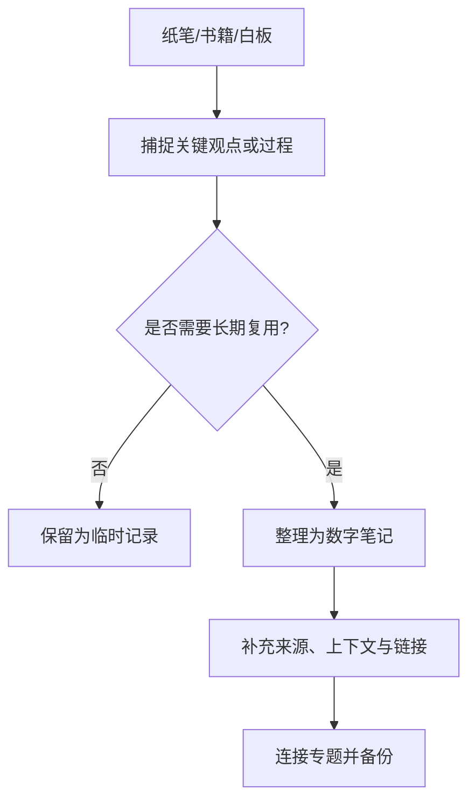

# 传统学习工具

传统工具包括纸质笔记、书籍、索引卡、白板和手绘草图。它们适合低干扰思考、推导、现场记录与快速表达，但全文检索、复制、备份和跨设备使用通常不如数字系统方便。

## 不同工具适合做什么

| 工具 | 优势 | 适合任务 |
|---|---|---|
| 纸笔 | 启动快、低干扰 | 随手记录、推导、草图 |
| 书籍 | 结构完整、适合连续阅读 | 系统学习与深入理解 |
| 索引卡 | 单点观点、便于重排 | 卡片笔记与观点连接 |
| 白板 | 大范围可视化 | 架构讨论、流程和头脑风暴 |
| 纸质清单 | 一目了然 | 当日行动与现场检查 |

## 与数字知识库配合

## 维护原则

1. 纸笔用于思考，不必把所有内容逐字数字化。
2. 对重要实验、决策和现场观察，记录日期、条件、结果和结论。
3. 数字化时保留必要的原始照片或扫描件，并写清它们为何重要。
4. 只转录长期有价值的内容，避免重复维护两份完整正文。
5. 涉及工作现场或他人资料时，遵守保密和版权要求。