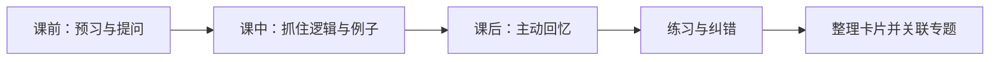

# 传统课堂学习

传统课堂的优势是即时互动、教师引导、共同讨论和结构化节奏。课堂输入仍需通过主动回忆、练习和课后复盘，才能转化为自己的理解。

## 课前、课中、课后

### 课前
- 浏览主题和先修知识，写下两三个想回答的问题。
- 检查所需教材、工具或实验材料。

### 课中
- 记录关键定义、推导步骤、例子和未解决疑问。
- 不必逐字抄写所有内容，优先记录逻辑关系、老师强调的条件和反例。
- 遇到不懂的地方标记问题，及时提问或课后核查。

### 课后
- 合上资料，用自己的话复述核心内容。
- 对照笔记补齐遗漏，并独立完成练习。
- 将长期有价值的观点沉淀到 [[卡片笔记]]，链接到对应专题。

课堂笔记应服务于理解与复习，而不是成为完整逐字稿。