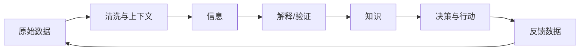

- 信息是指音讯、消息、信息系统传输和处理的对象，泛指人类社会传播的一切内容。

## 信息、数据与知识的区别

- **数据（Data）**：未经充分解释的记录，例如测量值、时间戳或报文原始字节。
- **信息（Information）**：经过整理、关联上下文后，能够回答某个问题的数据。
- **知识（Knowledge）**：对信息的结构、原因、规律和适用条件形成的理解。
- **行动/判断（Action/Judgment）**：在目标与约束下使用知识作出选择，并承担结果。

例如，CAN 抓包中的一串字节是数据；结合报文 ID、信号定义和时间戳后，可以判断某个信号的值，这是信息；进一步理解周期、状态机和异常原因，并通过实验验证，才形成可复用的工程知识。

知识记录应保留来源、上下文和适用范围，避免把单次观测误认为普遍规律。
