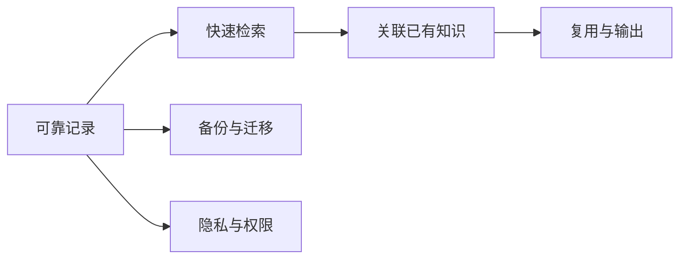

# 笔记软件功能需求

- 笔记创建与编辑
- 标签管理
- 文件附件
- 同步与分享
- 搜索
- 双向链接与反向链接
- 导入、导出和备份
- Markdown 与图表支持

## 功能价值链

## 评估问题

- **记录**：能否快速捕捉文字、代码、图片和附件？
- **检索**：是否支持全文搜索、过滤、标签和反向链接？
- **组织**：是否能兼顾稳定分类与跨主题关联？
- **可迁移性**：是否可导出开放格式，导出后链接与附件是否完整？
- **可靠性**：离线编辑、同步冲突、误删恢复和备份如何处理？
- **隐私**：分享权限、数据存储位置和敏感信息保护是否清楚？
- **可扩展性**：是否有插件、API、自动化和长期维护能力？

## 优先级判断

先保证记录、检索、备份和恢复，再改善链接与输出体验，最后考虑装饰性功能。功能清单应根据真实场景排序；功能越多不代表系统越好，稳定性、可迁移性和低维护成本同样重要。