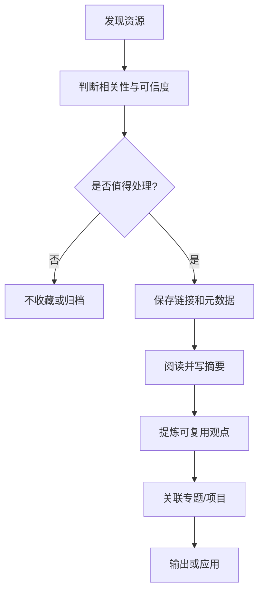

- 科技
- 设计
	- [anyway](https://anyway.fm/now/) 安妮薇看看
- 数据
- 博客
	- [xaoxuu](https://xaoxuu.com/) 一个开发`Hexo`主题的博客
- 播客
- 卡片笔记
	- [zettelkasten](https://zettelkasten.de/overview/) 卡片盒笔记
	- [capacities](https://capacities.io/) 卡片笔记软件
- 新闻
  collapsed:: true
	- [googlenews](https://googlenews.buzzing.cc/)  看新闻的网站
	- NOW [ycombinator](https://news.ycombinator.com/newest) Haker新闻
	  :LOGBOOK:
	  CLOCK: [2024-03-24 Sun 16:39:21]
	  :END:
		- [关于](https://www.buzzing.cc/#about)
		- [Hacker News 热门](https://www.buzzing.cc/#hn) ([hn.buzzing.cc](https://hn.buzzing.cc/))
		- [国外新闻头条](https://www.buzzing.cc/#news) ([news.buzzing.cc](https://news.buzzing.cc/))
		- [经济学人最新报道](https://www.buzzing.cc/#economistnew) ([economistnew.buzzing.cc](https://economistnew.buzzing.cc/))
		- [Reddit 热门](https://www.buzzing.cc/#reddit) ([reddit.buzzing.cc](https://reddit.buzzing.cc/))
		- [精神食粮](https://www.buzzing.cc/#depth) ([depth.buzzing.cc](https://depth.buzzing.cc/))
		- [彭博社最新报道](https://www.buzzing.cc/#bloombergnew) ([bloombergnew.buzzing.cc](https://bloombergnew.buzzing.cc/))
		- [Reddit新闻小组](https://www.buzzing.cc/#worldnews) ([worldnews.buzzing.cc](https://worldnews.buzzing.cc/))
		- [大西洋周刊](https://www.buzzing.cc/#atlantic) ([atlantic.buzzing.cc](https://atlantic.buzzing.cc/))
		- [BBC](https://www.buzzing.cc/#bbc) ([bbc.buzzing.cc](https://bbc.buzzing.cc/))
		- [中国话题](https://www.buzzing.cc/#china) ([china.buzzing.cc](https://china.buzzing.cc/))
		- [下饭视频](https://www.buzzing.cc/#videos) ([videos.buzzing.cc](https://videos.buzzing.cc/))
		- [Ars Technica](https://www.buzzing.cc/#arstechnica) ([arstechnica.buzzing.cc](https://arstechnica.buzzing.cc/))
		- [Product Hunt 热门](https://www.buzzing.cc/#ph) ([ph.buzzing.cc](https://ph.buzzing.cc/))
		- [国外科技头条](https://www.buzzing.cc/#tech) ([tech.buzzing.cc](https://tech.buzzing.cc/))
		- [Reddit 热门提问](https://www.buzzing.cc/#ask) ([ask.buzzing.cc](https://ask.buzzing.cc/))
		- [雅虎财经](https://www.buzzing.cc/#yahoo) ([yahoo.buzzing.cc](https://yahoo.buzzing.cc/))
		- [卫报](https://www.buzzing.cc/#theguardian) ([theguardian.buzzing.cc](https://theguardian.buzzing.cc/))
		- [国外股市热门](https://www.buzzing.cc/#stocks) ([stocks.buzzing.cc](https://stocks.buzzing.cc/))
		- [国外财经新闻](https://www.buzzing.cc/#finance) ([finance.buzzing.cc](https://finance.buzzing.cc/))
		- [Show HN](https://www.buzzing.cc/#showhn) ([showhn.buzzing.cc](https://showhn.buzzing.cc/))
		- [金融时报](https://www.buzzing.cc/#ft) ([ft.buzzing.cc](https://ft.buzzing.cc/))
		- [国外女权主义讨论](https://www.buzzing.cc/#feminism) ([feminism.buzzing.cc](https://feminism.buzzing.cc/))
		- [Lobste 最新提交](https://www.buzzing.cc/#lobste) ([lobste.buzzing.cc](https://lobste.buzzing.cc/))
		- [天空新闻](https://www.buzzing.cc/#sky) ([sky.buzzing.cc](https://sky.buzzing.cc/))
		- [谷歌全球新闻](https://www.buzzing.cc/#googlenews) ([googlenews.buzzing.cc](https://googlenews.buzzing.cc/))
		- [业余项目分享交流](https://www.buzzing.cc/#sideproject) ([sideproject.buzzing.cc](https://sideproject.buzzing.cc/))
		- [政客(Politico)](https://www.buzzing.cc/#politico) ([politico.buzzing.cc](https://politico.buzzing.cc/))
		- [Linux](https://www.buzzing.cc/#linux) ([linux.buzzing.cc](https://linux.buzzing.cc/))
		- [Hacker News 问答](https://www.buzzing.cc/#askhn) ([askhn.buzzing.cc](https://askhn.buzzing.cc/))
		- [Dev.to 热门](https://www.buzzing.cc/#dev) ([dev.buzzing.cc](https://dev.buzzing.cc/))
		- [自然杂志](https://www.buzzing.cc/#nature) ([nature.buzzing.cc](https://nature.buzzing.cc/))
		- [Big Think](https://www.buzzing.cc/#bigthink) ([bigthink.buzzing.cc](https://bigthink.buzzing.cc/))
		- [纽约客](https://www.buzzing.cc/#newyorker) ([newyorker.buzzing.cc](https://newyorker.buzzing.cc/))
		- [路透社最新报道](https://www.buzzing.cc/#reutersnew) ([reutersnew.buzzing.cc](https://reutersnew.buzzing.cc/))
		- [phys.org 最新](https://www.buzzing.cc/#phys) ([phys.buzzing.cc](https://phys.buzzing.cc/))
		- [加密货币国外热门讨论](https://www.buzzing.cc/#crypto) ([crypto.buzzing.cc](https://crypto.buzzing.cc/))
	-
	-
- Github搜藏
	- https://github.com/janhq/jan  一款离线本地的ChatGpt
- 数字花园
	- 收集的数字花园
		- [数字花园](https://dylandigitalgarden.com/%E6%95%B0%E5%AD%97%E8%8A%B1%E5%9B%AD)
		- [cat_Maeiee](https://www.maxieewong.com/cat_Maeiee%E7%9A%84%E6%95%B0%E5%AD%97%E8%8A%B1%E5%9B%AD.html)
		- [jefftay](https://jefftay.com/)
- 工作
	- https://automotive.wiki/

## 资源收集与维护规范

收藏的目的应是支持阅读、研究或工作，而不是无限增加链接。每条重要资源建议补充：标题、作者/机构、主题、来源链接、访问日期、可信度、适用场景和下一步动作。

### 资源类型

- **技术博客**：优先保留有代码、原理解释、实验结果或问题复盘的文章。
- **学术与研究**：记录论文标题、作者、发表年份、研究方法和局限，避免只保存摘要。
- **新闻与时事**：保留发布时间与原始来源；时效性内容需要定期复核。
- **播客与视频**：记录节目名称、嘉宾、时间戳和关键观点，方便再次定位。
- **知识管理**：将方法文章连接到 [[知识管理]]、[[卡片笔记]]、[[PARA]] 等专题，并记录自己的实践结论。

### 从收藏到知识

### 每月整理

- 检查失效链接和重复收藏。
- 将已读资源与待读资源区分开。
- 对高价值内容写出自己的总结，不复制大段原文。
- 对过时或不再有用的资源进行归档，而非让清单无限增长。
